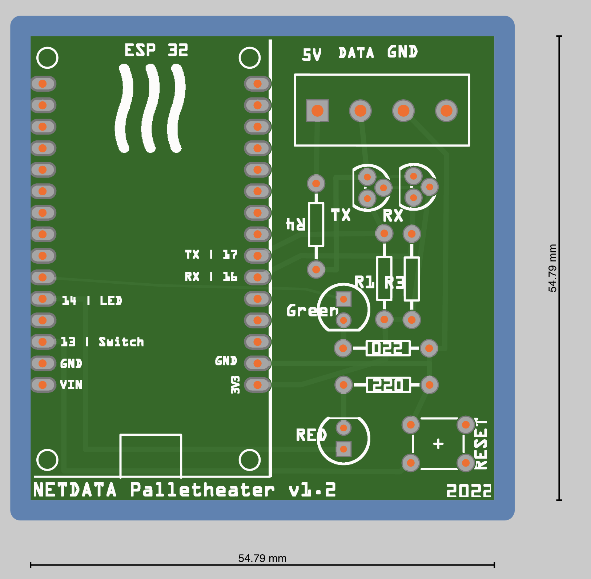
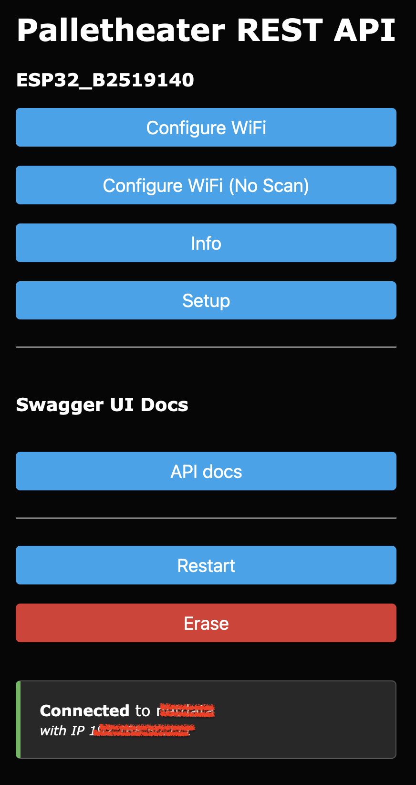
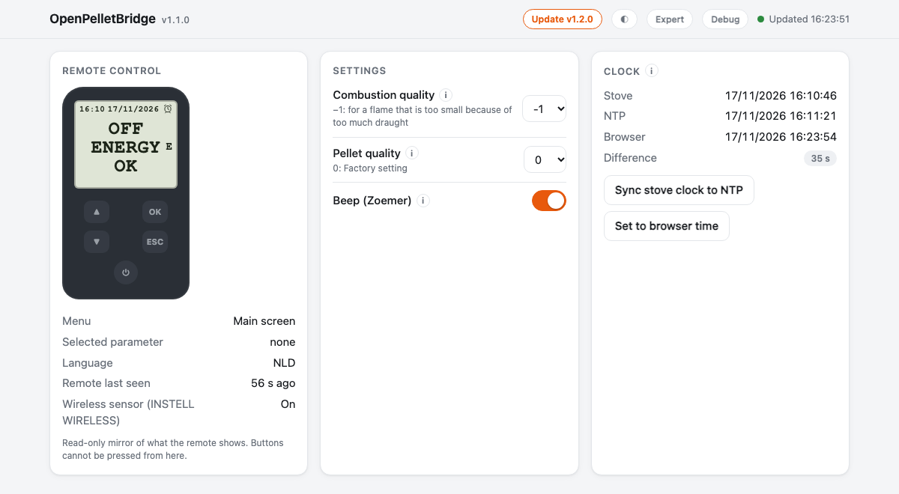
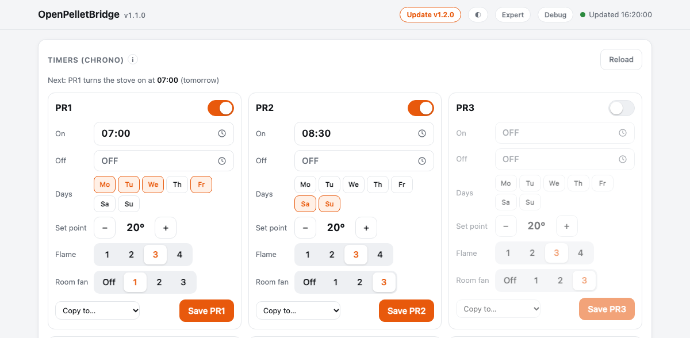
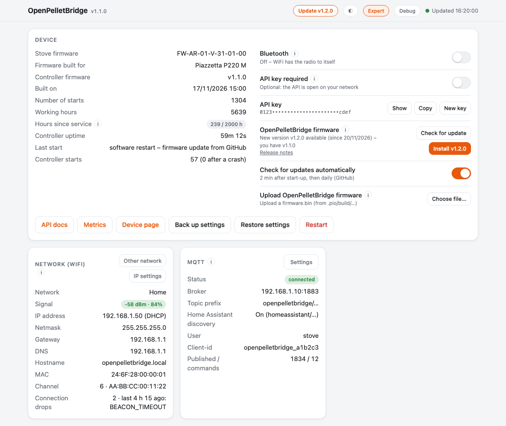
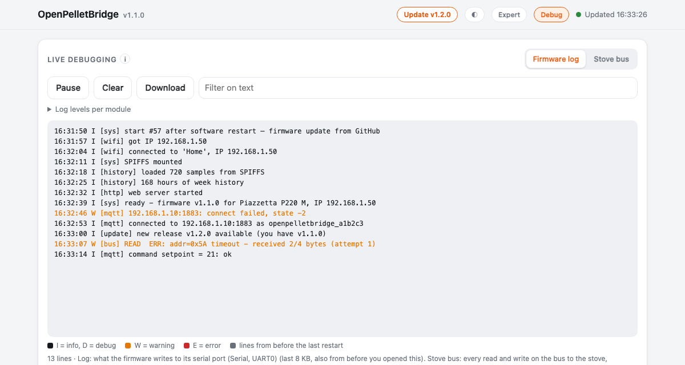

# OpenPelletBridge – REST API for Micronova pellet stoves

> **Nederlandstalige handleiding voor gebruikers: [docs/handleiding.md](docs/handleiding.md).** The technical documentation is listed under [Documentation](#documentation).

> Formerly **PalletHeater**. Renamed after v1.0.0: the default hostname is now `openpelletbridge.local` (a hostname set under *IP settings* is kept), the default MQTT prefix `openpelletbridge` and the release asset `openpelletbridge-firmware.bin` (since v1.1.7 releases no longer carry `palletheater-firmware.bin`: a controller on v1.0.0 needs one manual upload). JSON fields such as `lowPalletAlarm` and the metric `stove_low_pallet_alarm` keep their names for compatibility.

ESP32 firmware that connects to the serial bus of a Micronova based pellet stove and exposes it over:

- a **web app** on `/` to monitor and control the stove from any browser,
- an **HTTP REST API** ([docs/api.md](docs/api.md)),
- a **BLE GATT service** (see [BLE_API.md](BLE_API.md)), used by the iOS app in [app/](app/) (OpenPelletBridge board only: the DevKit firmware is built without Bluetooth, it no longer fits the DevKit's app slot),
- **Prometheus metrics** on `/metrics`,
- a **telnet** debug menu on port 23 (IPv4 and IPv6): status, control, timers, pellets, errors, network, firmware update, live log.

The full OpenAPI 3 specification is in [docs/openapi.json](docs/openapi.json). The same file is embedded in the firmware and rendered with Swagger UI on `http://<device>/api`.

## Documentation

| Document | Contents |
|---|---|
| [docs/handleiding.md](docs/handleiding.md) | Handleiding voor gebruikers (Nederlands) |
| [docs/api.md](docs/api.md) | REST API: conventions, authentication, every endpoint, stove states and error codes |
| [docs/mqtt.md](docs/mqtt.md) | MQTT and Home Assistant, metrics, Bluetooth, telnet |
| [docs/debugging.md](docs/debugging.md) | Serial link, live debugging, restart reason, core dump, firmware updates |
| [docs/development.md](docs/development.md) | Building and uploading, partitions, CI and releases, unit tests, source layout |
| [docs/discovered-values.md](docs/discovered-values.md) | What is known about the stove registers |
| [hardware/README.md](hardware/README.md) | Controller board (draft): schematic, BOM, design choices |
| [docs/openapi.json](docs/openapi.json) | OpenAPI 3 specification |

## Hardware

An ESP32 dev board (`esp32doit-devkit-v1`) on a custom PCB:

N-channel MOSFETs convert the 3.3 V TTL of the ESP32 to the 5 V TTL the stove expects. Micronova uses a single-wire serial bus where TX and RX are coupled, so everything the ESP32 transmits is also received; the firmware strips its own echo from the received bytes. The Fritzing design is in [Fritzing/](Fritzing/).

## Getting started

1. Flash the firmware (see [Development](docs/development.md#development)).
2. On first boot the device starts a WiFi captive portal. Connect to it and enter your WiFi credentials and NTP server.
3. Once connected, the device is reachable on its IP address or on `http://openpelletbridge.local` (mDNS).
4. Open `http://openpelletbridge.local/` for the web app, `http://openpelletbridge.local/device` for the fallback page or `http://openpelletbridge.local/api` for Swagger UI.

Hold the reset button for 5 seconds to wipe the WiFi settings and restart the captive portal.

## Web app

`http://openpelletbridge.local/` (also `/app`) is a single page web app built into the firmware ([web/app.html](web/app.html)). It has no external dependencies, so it also works without internet access, and adapts to phone and desktop screens and to light/dark mode (automatic, or fixed with the theme button).

### A tour of the app

*The screenshots use sample data; names and addresses are examples.*

**Overview.** The top card shows the state of the stove in words (here: standby because energy saving stopped it, and the temperature at which it starts again), the next timer action, the room temperature, set point and fume temperature, and the power button. Below it: set point, flame power and room fan; energy saving with its stop and restart temperatures; and the status values the stove reports. The *Update* button in the header appears when a newer firmware release is available.

**History.** One chart with a lane per quantity on a shared time axis: temperatures, flame power (set and actual), room fan and, on request, fume temperature, auger and fume fan speed. The dotted lines mark every change of the stove state (from the event log), labelled where there is room. Hover or tap for the values at that moment. Choose 30 min up to 24 h (a point every 2 minutes)…

…or *7 d*: hourly averages of the last week, with *Burning*, the share of each hour the stove was heating.

**Remote control, settings and clock.** A read-only copy of what the remote control shows (here *OFF / ENERGY / OK*: standby by energy saving after the stove has cooled down, with the chrono clock icon and the "E" for energy saving), the combustion and pellet quality corrections and the beep, and the stove clock next to NTP and the browser time with buttons to set it.

**Timers.** The six chrono programs of the stove: on and off time, days, set point, flame power and room fan per program, with *Copy to…* to reuse a program. Above them: what the next timer will do.

**Device, network and MQTT** (*Expert* on). Stove and controller firmware, what the firmware is built for, why the controller last (re)started and how often it crashed, Bluetooth and API key, the firmware update from GitHub (*Install vX*), settings backup and restore. *Network (WiFi)* shows the connection and how often it dropped and why; *Other network* and *IP settings* change it. *MQTT* shows the broker connection and opens its settings.

**Console** (button *Console* in the header, shown in Debug mode and whenever the stove does not answer; or Ctrl+`). A panel docked at the bottom like the browser's developer tools, with a draggable edge; it stays usable when the stove is unreachable. Three tabs: *Firmware log*, *Stove bus* and *Requests* (the API calls of the page itself with status and duration). *Firmware log* shows what the controller writes to its serial port, with the time; warnings are orange, errors red. After a restart it starts with the last lines from before it. *Log levels per module* sets how much each part writes.

*Stove bus* shows every read and write between the controller and the stove as one line: time, action, register (RAM or EEPROM and address), value (decimal and hex) and what the value means according to the known register table, with the previous value when it changed (*← was 140*). *Changes only* (on by default) shows the first reading of each register and after that only changes, writes and failures. The legend under the output explains the colours. *Raw bytes* adds the bytes of each transaction on the serial line, in hex or (*Binary*) in bits, with what each part is: TX is what the controller sends (read: type, address; write: 0x80 + type, address, value, checksum), RX what it receives: the echo of TX (the bus is one wire), then the stove's answer (checksum, value), with the checksum checked. A timeout shows how many bytes did arrive. Filter on addresses (`0x21, 0x6E`) or text; *Download* saves the lines.

**Dark mode.** The theme button in the header (◐ automatic, ☀ light, ☾ dark) switches between following your phone or computer and a fixed light or dark theme; the choice is kept per browser and included in a settings backup.

### Features

- **Status:** stove state, room / set point / fume temperatures, the sensor the room temperature comes from (derived from the readings), the wireless sensor setting, sensors, fume fan, auger speed, pellet level, error memory, stove vs NTP clock, firmware, starts and working hours. Refreshes every 5 s from `/api/state`.
- **Alerts:** a banner for alarms (states 8 – 10), an active error code, no answer from the stove, low pellets, stale data and an unreachable controller.
- **Settings backup:** *Back up settings* under *Device* downloads a JSON file with the stove settings, timers, MQTT (without password), network, device options and display choices; *Restore settings* writes the parts you tick back through the normal API (no passwords or API key in the file).
- **Status dots:** two dots in the header: *Stove* for the serial link between the controller and the stove (green OK, red the stove does not answer, orange data older than 30 s) and the controller dot for the connection between the page and the controller (green with the time of the last update, red offline). On a phone only the stove dot is shown.
- **Update badge:** when a newer release is available an *Update* button appears in the header, next to the version.
- **Home screen:** the app has a web app manifest and icon (`/manifest.webmanifest`, `/icon.svg`, `/icon-180.png`), so *Add to Home Screen* (iOS Safari, Android Chrome) gives it its own icon and a full-screen window. (Installing as a real PWA, and browser push notifications, need HTTPS with a certificate the device trusts: open `https://openpelletbridge.local/` after installing the controller's self-signed certificate on it, see [`/api/https`](docs/api.md#apihttps); the home screen shortcut works over HTTP too.)
- **History:** one chart for the last 30 min / 1 / 6 / 12 / 24 h or 7 days (hourly averages, with the share of each hour the stove was burning) (from `/api/history`) with toggles for room, set point, stove sensor, remote sensor, flame power, room fan, fume temperature, auger speed, fume fan speed and vertical lines at the exact stove state changes (from `/api/events`), plus a list of the state changes with their duration. Each quantity has its own lane and scale on a shared time axis, with one crosshair tooltip and a table view.
- **Remote control:** a read-only mirror of the remote display (time and date, room temperature, flame power blocks 1 – 4, room fan, "E" for energy saving, OFF screen, error, open menu) plus menu, selected parameter, language and last contact.
- **Controls:** power on/off, set point, flame power, room fan, energy saving, combustion and pellet quality, beep, clock sync, delete single errors or the whole error memory, restart.
- **Timers:** edit, enable/disable and copy PR1 – PR6 (to one program or all others), plus the next scheduled timer action. A program that could not be read from the stove is shown as *Read error* and cannot be saved, so a bad read is never written back.
- **Help:** (i) buttons next to settings, clock, timers and error codes with explanations taken from the stove manual (FWAR01).
- **Clock:** sync the stove clock to NTP or to the browser time.
- **Expert / Debug:** two toggles in the header (remembered per browser). *Expert* shows technical details: wireless sensor setting, fume fan, auger, brazier cleaning countdown, controller firmware / build / uptime, firmware upload, API / metrics links and the history table. *Debug* shows research and diagnostics: raw registers (room fan power RAM 0x0A, pellet reserve sensor / counter, raw remote edit value), serial errors and retries, the telnet switch and the EEPROM presets per power level (auger, fume fan). What is not verified yet is in [docs/discovered-values.md](docs/discovered-values.md).
- **Network and MQTT:** a *Network (WiFi)* card (network, signal, IP address, gateway, hostname; DHCP or static IP and hostname can be changed) and an *MQTT* card (connection status, broker, topic prefix, discovery; settings). A small page with links is on `/device`.
- **Unreachable:** when the controller does not answer every card is greyed out and disabled; when only the stove does not answer (state −1) every card except *Device* is.
- **Language:** Dutch when the remote control language is NLD, otherwise English; `/app?lang=nl` / `/app?lang=en` overrides it.

To change the app, edit `web/app.html` and rebuild; it is embedded gzipped via `board_build.embed_files` like the OpenAPI spec.
