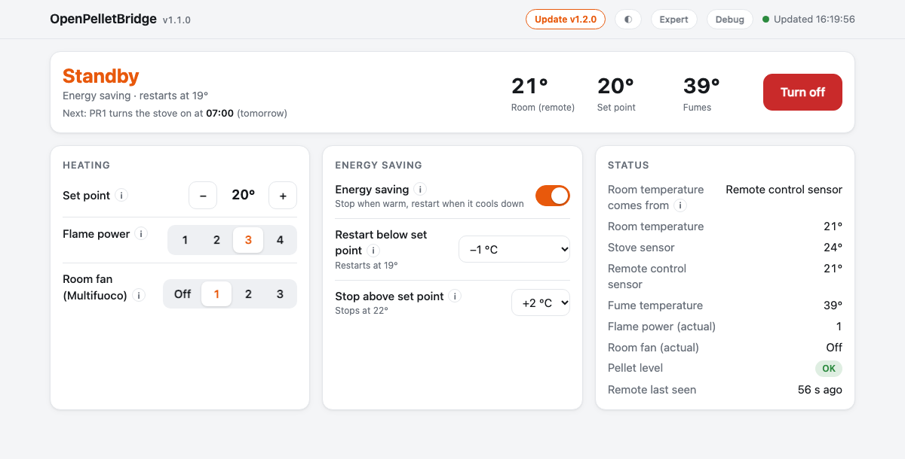
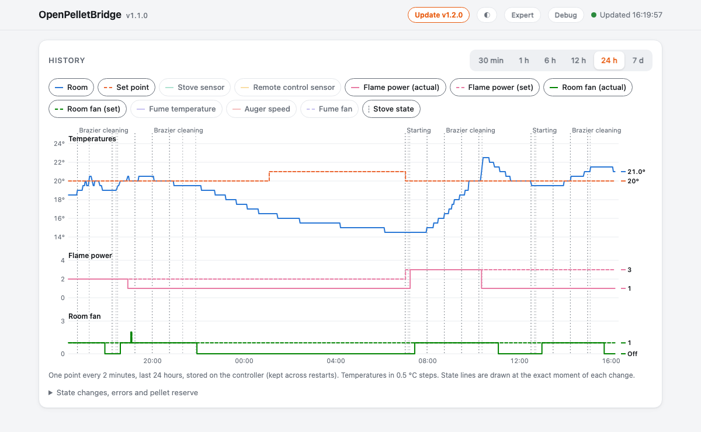
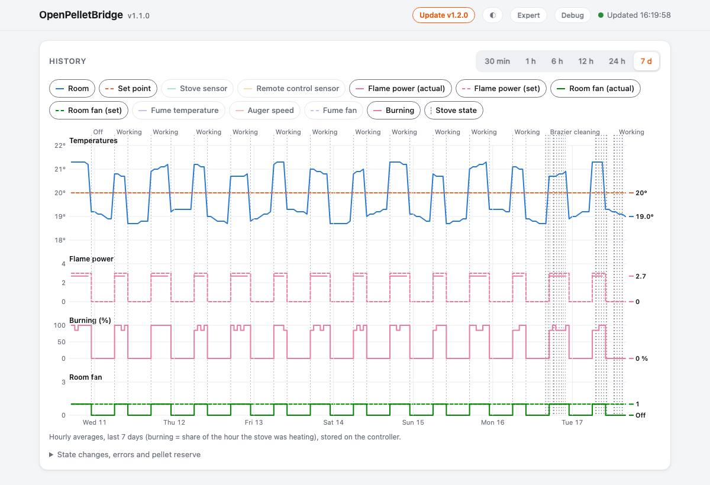
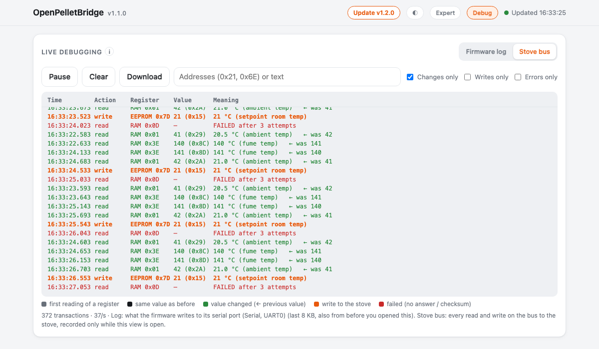
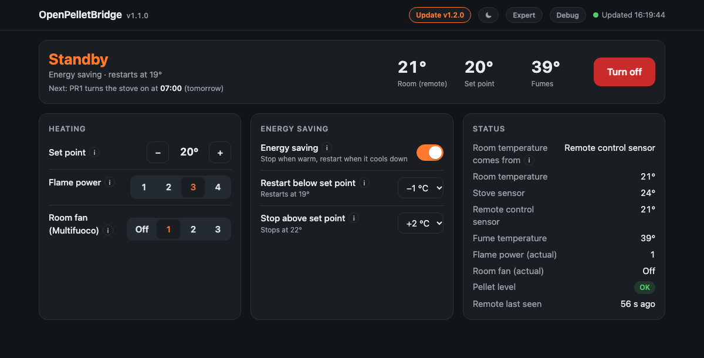

# OpenPelletBridge – REST API for Micronova pellet stoves

> Formerly **PalletHeater**. Renamed after v1.0.0: the default hostname is now `openpelletbridge.local` (a hostname set under *IP settings* is kept), the default MQTT prefix `openpelletbridge` and the release asset `openpelletbridge-firmware.bin` (releases still carry `palletheater-firmware.bin` for controllers on v1.0.0). JSON fields such as `lowPalletAlarm` and the metric `stove_low_pallet_alarm` keep their names for compatibility.

ESP32 firmware that connects to the serial bus of a Micronova based pellet stove and exposes it over:

- a **web app** on `/` to monitor and control the stove from any browser,
- an **HTTP REST API** (this document),
- a **BLE GATT service** (see [BLE_API.md](BLE_API.md)), used by the iOS app in [app/](app/),
- **Prometheus metrics** on `/metrics`,
- a **telnet** debug menu on port 23.

The full OpenAPI 3 specification is in [docs/openapi.json](docs/openapi.json). The same file is embedded in the firmware and rendered with Swagger UI on `http://<device>/api`.

## Table of contents

- [Hardware](#hardware)
- [Getting started](#getting-started)
- [Web app](#web-app)
- [API conventions](#api-conventions)
- [Endpoint overview](#endpoint-overview)
- [Endpoint reference](#endpoint-reference)
- [Reference tables](#reference-tables)
- [MQTT and Home Assistant](#mqtt-and-home-assistant)
- [Other interfaces](#other-interfaces)
- [Development](#development)

## Hardware

An ESP32 dev board (`esp32doit-devkit-v1`) on a custom PCB:


N-channel MOSFETs convert the 3.3 V TTL of the ESP32 to the 5 V TTL the stove expects. Micronova uses a single-wire serial bus where TX and RX are coupled, so everything the ESP32 transmits is also received; the firmware strips its own echo from the received bytes. The Fritzing design is in [Fritzing/](Fritzing/).

## Getting started

1. Flash the firmware (see [Development](#development)).
2. On first boot the device starts a WiFi captive portal. Connect to it and enter your WiFi credentials and NTP server.
3. Once connected, the device is reachable on its IP address or on `http://openpelletbridge.local` (mDNS).
4. Open `http://openpelletbridge.local/` for the web app, `http://openpelletbridge.local/device` for the fallback page or `http://openpelletbridge.local/api` for Swagger UI.


Hold the reset button for 5 seconds to wipe the WiFi settings and restart the captive portal.

## Web app

`http://openpelletbridge.local/` (also `/app`) is a single page web app built into the firmware ([web/app.html](web/app.html)). It has no external dependencies, so it also works without internet access, and adapts to phone and desktop screens and to light/dark mode (automatic, or fixed with the theme button).

### A tour of the app

*The screenshots use sample data; names and addresses are examples.*

**Overview.** The top card shows the state of the stove in words (here: standby because energy saving stopped it, and the temperature at which it starts again), the next timer action, the room temperature, set point and fume temperature, and the power button. Below it: set point, flame power and room fan; energy saving with its stop and restart temperatures; and the status values the stove reports. The *Update* button in the header appears when a newer firmware release is available.



**History.** One chart with a lane per quantity on a shared time axis: temperatures, flame power (set and actual), room fan and, on request, fume temperature, auger and fume fan speed. The dotted lines mark every change of the stove state (from the event log), labelled where there is room. Hover or tap for the values at that moment. Choose 30 min up to 24 h (a point every 2 minutes)…



…or *7 d*: hourly averages of the last week, with *Burning*, the share of each hour the stove was heating.



**Remote control, settings and clock.** A read-only copy of what the remote control shows (here *OFF / ENERGY / OK*: standby by energy saving after the stove has cooled down, with the chrono clock icon and the "E" for energy saving), the combustion and pellet quality corrections and the beep, and the stove clock next to NTP and the browser time with buttons to set it.


**Timers.** The six chrono programs of the stove: on and off time, days, set point, flame power and room fan per program, with *Copy to…* to reuse a program. Above them: what the next timer will do.


**Device, network and MQTT** (*Expert* on). Stove and controller firmware, what the firmware is built for, why the controller last (re)started and how often it crashed, Bluetooth and API key, the firmware update from GitHub (*Install vX*), settings backup and restore. *Network (WiFi)* shows the connection and how often it dropped and why; *Other network* and *IP settings* change it. *MQTT* shows the broker connection and opens its settings.


**Console** (button *Console* in the header, shown in Debug mode and whenever the stove does not answer; or Ctrl+`). A panel docked at the bottom like the browser's developer tools, with a draggable edge; it stays usable when the stove is unreachable. Three tabs: *Firmware log*, *Stove bus* and *Requests* (the API calls of the page itself with status and duration). *Firmware log* shows what the controller writes to its serial port, with the time; warnings are orange, errors red. After a restart it starts with the last lines from before it. *Log levels per module* sets how much each part writes.


*Stove bus* shows every read and write between the controller and the stove as one line: time, action, register (RAM or EEPROM and address), value (decimal and hex) and what the value means according to the known register table, with the previous value when it changed (*← was 140*). *Changes only* (on by default) shows the first reading of each register and after that only changes, writes and failures. The legend under the output explains the colours. *Raw bytes* adds the bytes of each transaction on the serial line, in hex or (*Binary*) in bits, with what each part is: TX is what the controller sends (read: type, address; write: 0x80 + type, address, value, checksum), RX what it receives: the echo of TX (the bus is one wire), then the stove's answer (checksum, value), with the checksum checked. A timeout shows how many bytes did arrive. Filter on addresses (`0x21, 0x6E`) or text; *Download* saves the lines.



**Dark mode.** The theme button in the header (◐ automatic, ☀ light, ☾ dark) switches between following your phone or computer and a fixed light or dark theme; the choice is kept per browser and included in a settings backup.



### Features

- **Status:** stove state, room / set point / fume temperatures, the sensor the room temperature comes from (derived from the readings), the wireless sensor setting, sensors, fume fan, auger speed, pellet level, error memory, stove vs NTP clock, firmware, starts and working hours. Refreshes every 5 s from `/api/state`.
- **Alerts:** a banner for alarms (states 8 – 10), an active error code, no answer from the stove, low pellets, stale data and an unreachable controller.
- **Settings backup:** *Back up settings* under *Device* downloads a JSON file with the stove settings, timers, MQTT (without password), network, device options and display choices; *Restore settings* writes the parts you tick back through the normal API (no passwords or API key in the file).
- **Status dots:** two dots in the header: *Stove* for the serial link between the controller and the stove (green OK, red the stove does not answer, orange data older than 30 s) and the controller dot for the connection between the page and the controller (green with the time of the last update, red offline). On a phone only the stove dot is shown.
- **Update badge:** when a newer release is available an *Update* button appears in the header, next to the version.
- **Home screen:** the app has a web app manifest and icon (`/manifest.webmanifest`, `/icon.svg`, `/icon-180.png`), so *Add to Home Screen* (iOS Safari, Android Chrome) gives it its own icon and a full-screen window. (Installing as a real PWA needs HTTPS, which the controller does not have; the home screen shortcut works over HTTP.)
- **History:** one chart for the last 30 min / 1 / 6 / 12 / 24 h or 7 days (hourly averages, with the share of each hour the stove was burning) (from `/api/history`) with toggles for room, set point, stove sensor, remote sensor, flame power, room fan, fume temperature, auger speed, fume fan speed and vertical lines at the exact stove state changes (from `/api/events`), plus a list of the state changes with their duration. Each quantity has its own lane and scale on a shared time axis, with one crosshair tooltip and a table view.
- **Remote control:** a read-only mirror of the remote display (time and date, room temperature, flame power blocks 1 – 4, room fan, "E" for energy saving, OFF screen, error, open menu) plus menu, selected parameter, language and last contact.
- **Controls:** power on/off, set point, flame power, room fan, energy saving, combustion and pellet quality, beep, clock sync, delete single errors or the whole error memory, restart.
- **Timers:** edit, enable/disable and copy PR1 – PR6 (to one program or all others), plus the next scheduled timer action. A program that could not be read from the stove is shown as *Read error* and cannot be saved, so a bad read is never written back.
- **Help:** (i) buttons next to settings, clock, timers and error codes with explanations taken from the stove manual (FWAR01).
- **Clock:** sync the stove clock to NTP or to the browser time.
- **Expert / Debug:** two toggles in the header (remembered per browser). *Expert* shows technical details: wireless sensor setting, fume fan, auger, brazier cleaning countdown, controller firmware / build / uptime, firmware upload, API / metrics links and the history table. *Debug* shows research and diagnostics: raw registers (room fan power RAM 0x0A, pellet reserve sensor / counter, raw remote edit value), serial errors and retries, the telnet switch, a table of the known EEPROM parameters (presets per power level, settings, counters) and a table of the register hypotheses with live values (read with `/api/dump` only while debug is on).
- **Network and MQTT:** a *Network (WiFi)* card (network, signal, IP address, gateway, hostname; DHCP or static IP and hostname can be changed) and an *MQTT* card (connection status, broker, topic prefix, discovery; settings). A small page with links is on `/device`.
- **Unreachable:** when the controller does not answer every card is greyed out and disabled; when only the stove does not answer (state −1) every card except *Device* is.
- **Language:** Dutch when the remote control language is NLD, otherwise English; `/app?lang=nl` / `/app?lang=en` overrides it.

To change the app, edit `web/app.html` and rebuild; it is embedded gzipped via `board_build.embed_files` like the OpenAPI spec.

## API conventions

- **Base URL:** `http://<device-ip>` or `http://openpelletbridge.local`. Port 80, plain HTTP. Only expose it on a trusted network.
- **API key (optional):** see [Authentication](#authentication).
- **Request parameters:** write operations take **query parameters** (form-encoded bodies also work), e.g. `POST /api/flame?power=3`. Only the timer endpoints take a **JSON body**.
- **Responses:** always `application/json`, except `/metrics` (Prometheus text), `/`, `/api` (HTML) and `/restart` (plain text).
- **Write responses** contain a `result` field (`"success"` or an error message) plus the value read back from the stove after the write.
- **Status codes:**

  | Code | Meaning |
  |---|---|
  | `200` | Success |
  | `202` | Accepted but nothing changed (e.g. power on while already on) |
  | `400` | Invalid parameter value |
  | `405` | HTTP method not supported on this route |
  | `500` | Serial communication with the stove failed |
  | `503` | The stove bus is busy (another request held it for more than 5 s). Retry. |

- **Caching:** `/api/state` and `/metrics` are served from a cache that a background task keeps up to date. All other endpoints talk to the stove directly, so each call takes a few serial round trips.
- **Bus locking:** the serial bus is shared with the background sensor task and BLE. Every endpoint that talks to the stove takes the bus lock first, so requests are handled one at a time on the bus.
- **Retries:** every serial read and write is retried up to 3 times by the firmware before an endpoint reports a `500`. Clients do not need their own retry logic. Failures and retries are counted in `/metrics` (`stove_serial_read_errors_total`, `stove_serial_write_errors_total`, `stove_serial_retries_total`).

## Authentication

The controller generates a random 128-bit API key (32 hex characters) on first boot and keeps it in NVS; an existing key is reused. Using it is **optional** and off by default.

When the key is **required**, every route needs one of these headers, otherwise the response is `401`:

```bash
curl -H "X-API-Key: <key>" http://openpelletbridge.local/api/state
curl -H "Authorization: Bearer <key>" http://openpelletbridge.local/metrics
```

Always reachable without key: `/` and `/app` (web app), `/device` (fallback page), `/api/health` (for monitoring), `/api` + `/api-specs.json` (API docs, use **Authorize** in Swagger UI) and `/api/auth`.

| Call | Effect |
|---|---|
| `GET /api/auth` | `{ "required": false, "key": "…" }`. The key is only returned to authorised callers (or while it is not required). |
| `POST /api/auth?required=true` | Require the key (`false` makes it optional again). Needs the key while it is required. |
| `POST /api/auth?rotate=true` | Generate a new key. |

The web app (Device card) shows, copies and rotates the key and asks for it once when needed. The key is also printed on the serial console at boot. Plain HTTP is not encrypted: the key protects against other devices and web pages on the network, not against someone sniffing traffic. Telnet and BLE are not covered by the key; telnet can be switched off with [`/api/telnet`](#apitelnet).

For Prometheus:

```yaml
scrape_configs:
  - job_name: openpelletbridge
    authorization:
      credentials: "<key>"
    static_configs:
      - targets: ["openpelletbridge.local:80"]
```

## Endpoint overview

| Method | Path | Description |
|---|---|---|
| `GET` | [`/api/state`](#get-apistate) | All stove info in one call (cached) |
| `GET` | [`/api/health`](#get-apihealth) | Serial link health check |
| `GET` `POST` | [`/api/power`](#apipower) | Get or switch the power state |
| `GET` `POST` | [`/api/flame`](#apiflame) | Flame power 1 – 4 |
| `GET` `POST` | [`/api/fan`](#apifan) | Room fan speed 0 – 3 |
| `GET` `POST` | [`/api/setpoint`](#apisetpoint) | Room temperature set point 7 – 30 °C |
| `GET` `POST` | [`/api/energysaving`](#apienergysaving) | Energy saving start/stop offsets |
| `GET` `POST` | [`/api/burn`](#apiburn) | Combustion quality and pellet quality |
| `GET` `POST` | [`/api/beep`](#apibeep) | Stove beep on/off |
| `GET` `PATCH` | [`/api/time`](#apitime) | Stove clock vs NTP, sync clock |
| `GET` `POST` | [`/api/errors`](#apierrors) | Error memory (5 positions) |
| `GET` `POST` | [`/api/timers`](#apitimers) | All chrono programs PR1 – PR6 |
| `GET` `POST` `PATCH` `DELETE` | [`/api/timers/pr{1-6}`](#apitimerspr1-6) | Single chrono program |
| `GET` | [`/api/remote`](#get-apiremote) | Current menu on the remote / display |
| `GET` | [`/api/dump`](#get-apidump) | Raw RAM / EEPROM register dump |
| `GET` `POST` `DELETE` | [`/api/keywatch`](#apikeywatch) | Fast watch of a few RAM addresses (reverse engineering) |
| `GET` | [`/api/history`](#get-apihistory) | Last 24 h (2-min samples) or 7 days (hourly averages) |
| `GET` | [`/api/log`](#live-debugging) | Live firmware log (cursor) |
| `GET` `POST` | [`/api/busmon`](#live-debugging) | Live stove bus monitor (cursor) |
| `GET` `POST` | [`/api/loglevel`](#live-debugging) | Log level per firmware module |
| `POST` | [`/api/diag/reset`](#live-debugging) | Reset the serial counters (`serial=true`) and / or the crash counter (`crashes=true`) |
| `GET` | [`/api/events`](#get-apievents) | Log of stove state changes and errors with exact times |
| `GET` `POST` | [`/api/bluetooth`](#apibluetooth) | Enable / disable Bluetooth (BLE) |
| `GET` `POST` | [`/api/mqtt`](#apimqtt) | MQTT settings and status |
| `GET` `POST` | [`/api/wifi`](#apiwifi) | WiFi status, network, hostname and DHCP / static IP |
| `GET` | [`/api/wifi/scan`](#apiwifi) | WiFi networks in range |
| `GET` `POST` | [`/api/telnet`](#apitelnet) | Enable / disable the telnet menu |
| `GET` `POST` | [`/api/auth`](#authentication) | API key status, require, rotate |
| `POST` | [`/api/update`](#post-apiupdate) | Firmware update over HTTP |
| `GET` `POST` | [`/api/firmware`](#apifirmware) | Check GitHub for a new firmware release and install it |
| `GET` | [`/metrics`](#get-metrics) | Prometheus metrics |
| `GET` | [`/`](#web-app) | Web app (also on `/app`) |
| `GET` | `/device` | Small fallback page (IP, SSID, RSSI, uptime, links) |
| `GET` | `/restart` | Reboot the ESP32 |
| `GET` | `/api` | Swagger UI |
| `GET` | `/api-specs.json` | OpenAPI specification |
| | [Legacy routes](#legacy-routes) | `/on`, `/off`, `/state`, `/flame`, `/fan`, `/get`, `/set`, `/error`, `/cq`, `/display` |

## Endpoint reference

The examples use `curl` against `openpelletbridge.local`.

### `GET /api/state`

Everything you need for a dashboard in one call, served from cache.

```bash
curl http://openpelletbridge.local/api/state
```

```json
{
  "stoveState": { "stoveState": 4, "state": "Working", "poweredOn": true },
  "flame": { "power": 2, "actual": 1 },
  "bluetooth": true,
  "temperatures": { "room": 20.5, "stove": 21.0, "remoteControl": 20.5, "setPoint": 21, "fume": 118 },
  "wirelessSensor": "off",
  "energySaving": { "start": -1, "stop": 2, "enabled": true, "startTemperature": 20, "stopTemperature": 23 },
  "RoomFanSpeed": 2,
  "roomFan": { "speed": 2, "actual": 2, "running": true, "mode": "on", "hotEnough": true, "drive": 23 },
  "lowPalletAlarm": 0,
  "pelletReserve": { "enabled": true, "sensor": 0, "counter": 20 },
  "brazierCleaning": { "minutesLeft": 12, "active": false, "interval": 45 },
  "stoveBeepEnabled": true,
  "numberOfStarts": 412,
  "hoursSinceLastService": 213,
  "totalRuntime": 1873,
  "firmwareVersion": "FW-PZ-02-V-01-04-00",
  "augerSpeed": 2.4,
  "burn": { "combustionQuality": "0", "pelletQuality": "0" },
  "fumeFanRPM": 1550,
  "RemoteControlLastSeen": 12,
  "previousErrors": false,
  "time": { "ntp": "2026-11-15 17:50:06", "stove": "2026-11-15 17:49:35", "delta": 31 },
  "dataAge": { "fastSeconds": 2, "slowSeconds": 9 },
  "serial": { "readErrors": 0, "writeErrors": 0, "retries": 3 },
  "uptime": { "seconds": 93784, "human": "1d 02h 03m 04s" },
  "controller": { "version": "674b88d-dirty", "built": "2026-11-16T17:05:12Z", "branch": "master", "env": "esp32doit-devkit-v1-http" }
}
```

| Field | Description |
|---|---|
| `stoveState` | Numeric state, label and `poweredOn` flag. See [stove states](#stove-states). |
| `flame.power` / `flame.actual` | Set flame power (EEPROM `0x7F`) and the power the stove actually runs at (RAM `0x34`); when the set point is reached the stove modulates down, e.g. set 2, actual 1. |
| `bluetooth` | `true` when BLE is running on the controller (see [`/api/bluetooth`](#apibluetooth)). |
| `hydro` | `{ "Pressure", "Temp" }`, only present when hydro mode is enabled in `/config.txt` on SPIFFS. |
| `temperatures.room` | Room temperature as used by the stove (RAM `0x01`). Comes from the sensor selected in the MULTICOMFORT menu (remote control, stove or wireless sensor); without contact with the remote / wireless sensor for more than 4 minutes the stove falls back to its own sensor. The MULTICOMFORT register is not known yet. |
| `wirelessSensor` | Installer setting *INSTELL WIRELESS* (bit 0 of RAM `0xB6`): `on` / `off` = external wireless temperature sensor enabled, `unknown` until the first read. Read-only: it can only be changed on the remote control, see [docs/discovered-values.md](docs/discovered-values.md#instell-wireless-wireless-temperature-sensor). |
| `temperatures.stove` / `remoteControl` | Raw readings of the stove sensor and the remote control sensor (°C). |
| `temperatures.fume` | Exhaust temperature (°C). |
| `energySaving` | See [`/api/energysaving`](#apienergysaving). |
| `lowPalletAlarm` | `1` when the pellet level is low. |
| `pelletReserve` | `enabled` (installer setting PELLET RESERVE), `sensor` (RAM 0xA4: `5` = the level sensor sees low pellets), `counter` (RAM 0x89) and `minutesLeft`: while the sensor reports low pellets RAM 0x89 counts down from 20 to 0, about one step per minute, to the reserve alarm; `null` otherwise. |
| `pendingError` | The error the stove reports right now (RAM 0x33), also before it counts as `currentError`, with `secondsLeft`: seconds until the stove acts on it (RAM 0x30). E1 (hopper lid open) gives 55 s; closing the lid in time clears it. `null` without an error. The web app shows it as an alert with the countdown. |
| `brazierCleaning` | `minutesLeft`: minutes to the next brazier cleaning (RAM 0x32), `null` when the stove is not working; `active`: `true` while the cleaning runs (state 5); `interval`: minutes between cleanings (EEPROM 0x02). |
| `totalRuntime` | Total working hours. |
| `augerSpeed` | Auger speed in rpm. |
| `RemoteControlLastSeen` | Seconds since the last contact with the remote control, `-1` when unknown. |
| `previousErrors` | `false` when the error memory is empty, otherwise an object with the non-empty positions. See [`/api/errors`](#apierrors). |
| `time.delta` | NTP time minus stove time, in seconds. |
| `dataAge` | Seconds since the cache was last refreshed: `fastSeconds` (state, flame, fan, fumes; every ~2 – 4 s) and `slowSeconds` (temperatures, settings, timers; every ~16 – 60 s). `null` until the first refresh. A large value means the stove is not answering. |
| `serial` | Serial bus counters since boot: reads / writes that failed after all retries, and individual retries. |
| `currentError` | Active error: `false`, or `{ "id", "error", "desc", "source" }`. `source` `stove`: an error code of the stove (RAM `0x33`, like the error memory). `source` `controller`: `{"id": -1, "error": "LINK", "desc": "No answer from the stove (serial link down)"}` while the stove does not answer. |
| Unknown values | Values never read from the stove since the start are `null`; once read, the last known value stays (see `dataAge`). While the stove does not answer `stoveState.poweredOn` and `brazierCleaning.active` are `null` too. |
| `controller` | Controller (ESP32) firmware build: `version` from `git describe --tags --always --dirty` (`-dirty` = built with uncommitted changes), `built` build time in UTC, `branch`, PlatformIO `env`. Generated by [scripts/buildinfo.py](scripts/buildinfo.py) on every build. Also exported as the Prometheus metric `esp32_build_info`. |

On a serial error the cache keeps the last known value, so a failed read never shows up as `-1` or `255`.

### `GET /api/health`

Checks whether the stove answers on the serial bus.

```bash
curl http://openpelletbridge.local/api/health
# 200 {"health":"Healthy"}
# 500 {"health":"Failed to talk to Stove"}
```

### `/api/power`

```bash
curl http://openpelletbridge.local/api/power
# {"stoveState":0,"state":"Off","poweredOn":false}

curl -X POST "http://openpelletbridge.local/api/power?state=on"
# 200 {"result":"Powered on sent","stoveState":1,"state":"Starting","poweredOn":true}
# 202 {"result":"Stove already on","stoveState":4,"state":"Working","poweredOn":true}
```

| Parameter | Values |
|---|---|
| `state` | `on`, `off` |

- `on` only acts when the stove is `Off` (state 0); otherwise `202 Stove already on`.
- `off` writes state `0` while starting / pellet loading and state `6` (final cleaning) while igniting / working. When the stove is already off, in standby, or cleaning, it returns `202`.

### `/api/flame`

```bash
curl http://openpelletbridge.local/api/flame
# {"power":2}

curl -X POST "http://openpelletbridge.local/api/flame?power=3"
# {"result":"success","power":3}
```

| Parameter | Values |
|---|---|
| `power` | `1` – `4` |

### `/api/fan`

```bash
curl http://openpelletbridge.local/api/fan
# {"speed":2}

curl -X POST "http://openpelletbridge.local/api/fan?speed=0"
# {"result":"success","speed":0}
```

| Parameter | Values |
|---|---|
| `speed` | `0` (off) – `3` |

### `/api/setpoint`

```bash
curl http://openpelletbridge.local/api/setpoint
# {"setpoint":21}

curl -X POST "http://openpelletbridge.local/api/setpoint?value=22"
# {"result":"success","setpoint":22}
```

| Parameter | Values |
|---|---|
| `value` | `7` – `30` (°C) |

### `/api/energysaving`

Energy saving: when the room reaches the set point the stove goes to power 1; when it keeps rising to `setpoint + stop` the stove extinguishes (standby); when it drops below `setpoint + start` it restarts. `stop = 0` (OFF) disables energy saving (the stove only modulates); `start = 0` (OFF) means the stove does not restart automatically after stopping. `enabled` is `true` when `stop` is set.

```bash
curl http://openpelletbridge.local/api/energysaving
# {"energySaving":{"start":-1,"stop":2,"enabled":true,"startTemperature":20,"stopTemperature":23}}

curl -X POST "http://openpelletbridge.local/api/energysaving?start=-1&stop=2"
# {"result":"success","energySaving":{...}}
```

| Parameter | Values |
|---|---|
| `start` | `-3`, `-2`, `-1`, `0` |
| `stop` | `0`, `1`, `2`, `3` |

Both parameters are optional; pass either one or both.

### `/api/burn`

Combustion quality and pellet quality correction (installer menu).

```bash
curl http://openpelletbridge.local/api/burn
# {"combustionQuality":"0","pelletQuality":"-1"}

curl -X POST "http://openpelletbridge.local/api/burn?combustionQuality=1&pelletQuality=-2"
# {"result":"success","combustionQuality":"1","pelletQuality":"-2"}

curl -X POST "http://openpelletbridge.local/api/burn?combustionQuality=%2BG"
# {"result":"success","combustionQuality":"+G","pelletQuality":"-2"}
```

| Parameter | Values |
|---|---|
| `combustionQuality` | `+G`, `-3`, `-2`, `-1`, `0`, `1`, `2`, `3` |
| `pelletQuality` | `-5` … `5` |

The leading `+` is optional (`+1` and `1`, `+G` and `G` are equivalent), so an unencoded `+` that a client turns into a space is accepted too. Responses always return positive values without a sign, except `+G`.

### `/api/beep`

```bash
curl http://openpelletbridge.local/api/beep
# {"enabled":true}

curl -X POST "http://openpelletbridge.local/api/beep?enabled=false"
# {"result":"success","enabled":false}
```

| Parameter | Values |
|---|---|
| `enabled` | `true`, `false`, `1`, `0` |

### `/api/time`

The stove has its own clock without DST support. The firmware compares it with NTP time.

```bash
curl http://openpelletbridge.local/api/time
# {"time":{"stove":"2026-11-15 17:50:12","ntp":"2026-11-15 17:50:38","delta":26}}

curl -X PATCH http://openpelletbridge.local/api/time
# {"result":"success Synced NTP time to stove","time":{"stove":"2026-11-15 17:51:00","ntp":"2026-11-15 17:51:01","delta":1}}
```

`PATCH` writes the current NTP time into the stove clock. Pass `datetime=YYYY-MM-DDTHH:MM[:SS]` (local time) to set a specific time instead, e.g. the browser time:

```bash
curl -X PATCH "http://openpelletbridge.local/api/time?datetime=2026-11-16T14:30:00"
```

The day of the week is written as 1 = Monday … 7 = Sunday, which the chrono timers depend on. The stove has no daylight saving time; set the clock again after the change. The stove clock is read from the stove every 5 min (every 10 s until a valid time has been read); in between the controller lets it tick on, so `stove`, `ntp` and `delta` are current on every request. A clock change made on the stove itself shows up after at most 5 min. A PATCH re-reads the stove clock right away.

### `/api/errors`

The stove keeps the last 5 errors in `MemoryPos_1` … `MemoryPos_5`.

```bash
curl http://openpelletbridge.local/api/errors
# {"previousErrors":false}
# {"previousErrors":{"MemoryPos_1":{"id":32,"error":"E1","desc":"Pellet loading door is open for too long or air pressure inside stove is wrong"}}}

# clear position 1
curl -X POST "http://openpelletbridge.local/api/errors?MemoryPos_1=0"
# {"action":"MemoryPos_1 set","previousErrors":false}
```

| Parameter | Values |
|---|---|
| `MemoryPos_1` … `MemoryPos_5` | Error id, see [error codes](#error-codes). `0` clears the position. Unknown ids return `400` and nothing is written. |

### `/api/timers`

The six chrono programs `PR1` – `PR6`. A disabled program returns its stored times and settings too, with `"enabled": false`. When a program cannot be read (after the serial retries) it is returned as `{"error": "Failed to read timer from stove - RS232 error"}` instead of partial data (and `GET /api/timers/prN` returns `500`).

```bash
curl http://openpelletbridge.local/api/timers
```

```json
{
  "timers": {
    "PR1": {
      "enabled": true,
      "on": "06:30",
      "off": "08:30",
      "enabled_on": { "monday": true, "tuesday": true, "wednesday": true, "thursday": true, "friday": true, "saturday": false, "sunday": false },
      "settings": { "setpoint": 21, "flame_power": 3, "RoomFanSpeed": 2 }
    },
    "PR2": { "enabled": false }
  }
}
```

`POST` updates several programs at once. Only the programs and fields present in the body are written:

```bash
curl -X POST http://openpelletbridge.local/api/timers \
  -H "Content-Type: application/json" \
  -d '{"timers":{"PR1":{"enabled":true,"on":"06:30","off":"08:30"},"PR2":{"enabled":false}}}'
# {"result":"success"}
```

Timer fields:

| Field | Values |
|---|---|
| `enabled` | `true` / `false` |
| `on`, `off` | `HH:MM` on a 10 minute boundary (`06:30`, not `06:35`), or `off` |
| `enabled_on.<day>` | `monday` … `sunday`: `true` / `false`. If you send `enabled_on`, days you leave out are disabled. |
| `settings.setpoint` | `7` – `30` |
| `settings.flame_power` | `1` – `4` |
| `settings.RoomFanSpeed` | `0` – `3` |

The whole body is validated before anything is written. Invalid values, unknown program names or unknown days return `400` with an `error` message, and nothing is written:

```json
{ "error": "PR1: 'on' must be HH:MM on a 10 minute boundary or 'off'" }
```

### `/api/timers/pr{1-6}`

Single program, path `pr1` … `pr6`.

| Method | Body | Effect |
|---|---|---|
| `GET` | – | Return the program |
| `POST` | none | Enable the program, keep its settings |
| `POST` | JSON timer object | Partial update (same as `PATCH`). Not a full replace. |
| `PATCH` | JSON timer object | Partial update, only provided fields are written |
| `DELETE` | – | Disable the program (times and settings are kept) |

```bash
curl -X PATCH http://openpelletbridge.local/api/timers/pr1 \
  -H "Content-Type: application/json" \
  -d '{"off":"09:00","settings":{"setpoint":22}}'
# {"result":"success","PR1":{"enabled":true,"on":"06:30","off":"09:00",...}}

curl -X DELETE http://openpelletbridge.local/api/timers/pr1
# {"result":"success","PR1":{"enabled":false}}
```

### `GET /api/remote`

What the remote control / display currently shows. Useful for reverse engineering.

```bash
curl http://openpelletbridge.local/api/remote
# {"displayed_menu":"Main screen","diplayed_menu":"Main screen","selected_parameter":"Flame power","language":"NLD","menuId":0,"parameterId":0,"editValue":0}
```

`menuId` is the raw id of the screen on the remote (RAM `0x1A`, 0 = main screen), `parameterId` the parameter being edited (RAM `0x18`, 0 = none) and `editValue` the value the remote shows while editing, before it is confirmed (RAM `0x19`). The web app uses these to mirror the remote's display.

`diplayed_menu` is a deprecated, misspelled alias of `displayed_menu` kept for existing clients. It will be removed in a future release.

### `/api/keywatch`

Reverse-engineering aid to find what the remote control does when a key is pressed. The remote talks to the stove over radio, so only its effect in the stove RAM can be seen, and some registers change for well under a second. While a watch runs the controller stops its normal polling and reads only the chosen RAM addresses back to back (about 20 reads per second in total), logging every change with a millisecond timestamp. Read-only: nothing is written to the stove. `/api/state` is not refreshed during a watch.

| Method | Parameters | |
|---|---|---|
| `POST` | `address` (max 8, default `0x08,0x15,0x16,0x18,0x19,0x1A,0x24`), `seconds` (1 – 300, default 60) | Start a watch; clears the log |
| `GET` | | Status and log |
| `DELETE` | | Stop |

```bash
curl -X POST "http://openpelletbridge.local/api/keywatch?address=0x08,0x16,0x24&seconds=60"
curl "http://openpelletbridge.local/api/keywatch"
```

```json
{
  "active": true, "remainingSeconds": 42, "started": 1794901687, "elapsedMs": 18120,
  "reads": 362, "readErrors": 0, "readsPerSecond": 20.0, "overflow": false,
  "addresses": { "0x08": { "start": 0, "now": 0 }, "0x16": { "start": 0, "now": 0 }, "0x24": { "start": 0, "now": 0 } },
  "events": [ { "ms": 5310, "addr": "0x08", "from": 0, "to": 8 }, { "ms": 5460, "addr": "0x08", "from": 8, "to": 0 } ]
}
```

`ms` is the time since the start of the watch (`started`, Unix time). The log holds 600 changes; `overflow` is `true` when more were dropped.

### `GET /api/dump`

Raw register dump for reverse engineering. Each register is read over the serial bus, so a full dump takes several seconds.

| Parameter | Values |
|---|---|
| `register` | `ram` (default), `eeprom`, `all`. Add `unknown` (e.g. `ram,unknown`) to only return addresses that are not decoded yet. |
| `address` | Comma separated list, decimal or hex (`0x21,0x34,125`). Default: all 256. |

```bash
curl "http://openpelletbridge.local/api/dump?register=ram&address=0x21,0x34"
```

```json
{
  "RAM(0x00)": {
    "0x21": { "Address_int": 33, "Value_int": 4, "Value_txt": "Working", "Value_hex": "0x04" },
    "0x34": { "Address_int": 52, "Value_int": 2, "Value_txt": "Flame power 2", "Value_hex": "0x02" }
  }
}
```

Known addresses are documented in [docs/discovered-values.md](docs/discovered-values.md).

### `GET /api/history`

The controller keeps one sample every 2 minutes for the last 24 hours (720 samples). Samples are kept in RAM and every sample is also appended to SPIFFS (`/hist_a.bin` and `/hist_b.bin`, rotated every 24 h), so the history survives a restart, an OTA update or a power cut; at most the last sample is lost. Appending ≈16 bytes per 2 minutes keeps flash wear far below the endurance of the 128 KB SPIFFS partition. Samples are only recorded once NTP time and stove data are available.

| Parameter | Values |
|---|---|
| `hours` | `1` – `24` (default `24`): the 2-minute samples. `25` – `168`: hourly averages of the last 7 days (see below). |

```bash
curl "http://openpelletbridge.local/api/history?hours=6"
```

```json
{
  "interval": 120,
  "fields": ["t", "room", "stove", "remote", "setpoint", "fume", "flame", "state", "fan", "flameActual", "auger", "fumeFan", "fanActual", "fanPower"],
  "samples": [[1794843000, 20.5, 22.0, 20.5, 22, 118, 2, 4, 1, 2, 1.6, 2650, 1, 21], [1794843120, 20.5, 22.0, 20.5, 22, 119, 2, 4, 1, 1, 1.2, 2590, 1, 21]]
}
```

`t` is Unix time (UTC), temperatures in °C (0.5 °C resolution as reported by the stove), `state` is the stove state code, `fan` the room fan speed, `flame` the set and `flameActual` the actual flame power, `auger` the auger (feed screw) speed in rpm, `fumeFan` the fume fan speed in rpm, `fanActual` the speed the room fan really ran at (0 = stopped), `fanPower` the raw room fan power (RAM 0x0A: 0 off, 21/23/25 at speed 1/2/3) (`null` for samples recorded by older firmware). Each sample is an array in the order of `fields`. Changes shorter than the 2 minute interval are not captured in the samples; use [`/api/events`](#get-apievents) for exact state changes.

**7 days (`hours` 25 – 168):** the 2-minute samples are also averaged per clock hour into 168 hourly records, kept in `/hist_week.bin` (one append per hour). After an update to firmware with this feature the week is filled from the 24 h history. The answer has `"interval": 3600` and the fields `t` (start of the hour), `room`, `stove`, `remote`, `fume`, `flame`, `flameActual`, `fan`, `fanActual`, `auger`, `fumeFan` (hourly averages), `setpoint` (last value), `fumeMax`, `state` (most frequent state), `burning` (% of the hour in a heating state 1 – 5) and `n` (samples in that hour). The hour in progress is included as the last record.

```bash
curl "http://openpelletbridge.local/api/history?hours=168"
# {"interval":3600,"fields":["t","room","stove","remote","setpoint","fume","fumeMax","flame","flameActual","fan","fanActual","auger","fumeFan","state","burning","n"],
#  "samples":[[1794841200,20.6,21.0,20.8,21,118,131,2.0,1.8,1.0,1.0,1.5,2610,4,100,30], …]}
```

### `GET /api/events`

Log of every stove state change and every change of the active error, with the exact time. The stove itself does not store when an error happened, so this log is the only source for error times. Values are read about once a second; the last 200 entries are kept and appended to SPIFFS (`/events.bin`), so the log survives restarts and costs only one small flash write per change. Changes are recorded once NTP time is available.

| Parameter | Description |
|---|---|
| `hours` | Optional, 1–720: only return changes from the last N hours. Default: all stored changes |

```bash
curl "http://openpelletbridge.local/api/events?hours=24"
```

```json
{"events": [
  {"t": 1794843000, "type": "state", "from": 7, "to": 1},
  {"t": 1794843065, "type": "state", "from": 1, "to": 2},
  {"t": 1794843600, "type": "error", "id": 4, "error": "E9"},
  {"t": 1794844200, "type": "error", "id": 0, "error": null}
]}
```

`t` is Unix time (UTC). For `type: "state"`, `from` and `to` are stove state codes (see `/api/state`); `from` is `null` for the first change after the log was empty. For `type: "error"`, `id` is the raw error value and `error` the code (`id` 0 / `error` null = error cleared). Errors are only logged once they last 30 s (3 minutes during start-up, pellet loading, ignition, brazier cleaning and shut-down) or the stove is in an alarm state; RAM 0x33 briefly shows E12 when brazier cleaning starts and stops and E1 during the start-up check, which are not errors. For `type: "pellet"`, `register` is `0xA4` (pellet reserve sensor) or `0x89` (pellet reserve counter) with the old and new value; these are logged to find out how the pellet reserve works. Oldest first. The web app uses the error entries to show when each error memory entry occurred.


Serial link events: `{"t": …, "type": "link", "up": false}` when the stove stopped answering on the serial bus, `"up": true` when it answered again (the chart draws them red / green). Brazier cleaning (state 5) is not logged as a state change: it is a short periodic step while working.

### `/api/pellets`

Pellets and burning hours left until the low pellet alarm. The controller counts the auger feed: the auger value (RAM 0x0D, fixed per flame power: 3.0 / 4.6 / 6.2 / 7.8) times the time, in "auger units". The level sensor (RAM 0xA4) trips at the same level in the hopper each time, so between two alarms exactly the pellets added in between were burned: kg per unit = kg added / units. The last 10 cycles are kept in NVS and averaged.

- **Refill:** detected when the alarm clears again (sensor back to normal for 30 s after it was low for at least 1 min), with the standard amount `refillKg` (15 kg). E1 (hopper lid) is not used: it does not always occur.
- **Topped up without an alarm, or another amount:** `POST /api/pellets?add=<kg>`, or *Refilled…* in the web app. While the alarm is on, `add` sets the amount of the coming refill instead of the standard one.
- **First estimate:** after one refill at the alarm and the next alarm. Each cycle after that makes it more accurate (`spread`).

| Method | Parameters |
|---|---|
| `GET` | – |
| `POST` | `add` (kg, 0 – 100), `refillKg` (kg, 1 – 100), `resetCalibration=true` |

```json
{"calibrated": true, "cycles": 3, "low": false, "lastRefillAt": 1794990120, "lastRefillKg": 15, "remainingKg": 6.2, "hoursLeft": 4.15, "hoursLeftAverage": 9.6,
 "alarmExpectedAt": 1795037700, "kgPerHour": 1.49, "refillKg": 15, "kgSinceAlarm": 15.0, "gramsPerUnit": 0.0668,
 "spread": 0.041, "averageAuger": 2.91, "averageHours": 168, "unitsSinceAlarm": 131740, "pendingKg": null,
 "history": [{"t": 1794990000, "kg": 15, "units": 224300, "gramsPerUnit": 0.0669}]}
```

`lastRefillAt` / `lastRefillKg`: time (Unix) and amount of the last refill, detected or entered with `add` (`null` before the first one). `hoursLeft` is the time at the current auger value (`null` while the auger does not feed); `hoursLeftAverage` and `alarmExpectedAt` use the average auger value of the hourly history of the last 7 days (from 6 hours of history). After the alarm the stove's own countdown takes over (`pelletReserve` in `/api/state`). `/api/state` has the same estimate under `pellets` (without the calibration detail); MQTT publishes `pellets_kg` and `pellets_hours` (at the average use).

### `/api/bluetooth`

Bluetooth (BLE) can be switched off to give WiFi the radio to itself. The setting is stored in NVS and applied at the next boot: with BLE off, `setupBLE()` and `bleLoop()` are skipped, the BT controller memory is released and WiFi modem sleep is disabled. The iOS app then only works via WiFi.

```bash
curl http://openpelletbridge.local/api/bluetooth
# {"enabled":true,"active":true,"restartRequired":false}

curl -X POST "http://openpelletbridge.local/api/bluetooth?enabled=false&restart=true"
# {"result":"success - restarting","enabled":false,"active":true,"restartRequired":true}
```

| Parameter | Values |
|---|---|
| `enabled` | `true`, `false` |
| `restart` | `true` to restart the controller right away when the setting changed (the stove keeps running) |

### `/api/mqtt`

MQTT settings and connection status, see [MQTT and Home Assistant](#mqtt-and-home-assistant). Stored in NVS; a change reconnects right away. The password is never returned.

```bash
curl -X POST "http://openpelletbridge.local/api/mqtt?enabled=true&host=192.168.1.10&user=ha&password=secret"
curl http://openpelletbridge.local/api/mqtt
# {"enabled":true,"host":"192.168.1.10","port":1883,"user":"ha","passwordSet":true,"prefix":"openpelletbridge",
#  "discovery":true,"discoveryPrefix":"homeassistant","clientId":"openpelletbridge_a1b2c3","connected":true,
#  "lastError":null,"publishes":42,"commands":0}
```

| Parameter (POST) | Values |
|---|---|
| `enabled` | `true` / `false` |
| `host`, `port` | Broker address, port (default 1883) |
| `user`, `password` | Optional. An empty `password` keeps the stored one, `-` clears it |
| `prefix` | Topic prefix, default `openpelletbridge` |
| `discovery`, `discoveryPrefix` | Home Assistant discovery on / off (default on), prefix (default `homeassistant`) |

Only the given parameters change.

### `/api/wifi`

WiFi status, the WiFi network and the IP settings. Hostname and IP settings are stored in NVS (shared with the BLE and telnet menus) and take effect after a restart; a network change is done right away. Without any working network, hold the reset button 5 s for the WiFiManager portal.

```bash
curl http://openpelletbridge.local/api/wifi
# {"connected":true,"ssid":"Home","bssid":"…","channel":6,"rssi":-61,"quality":78,"ip":"192.168.50.222","netmask":"255.255.255.0",
#  "gateway":"192.168.50.1","dns":"192.168.50.1","mac":"…","hostname":"openpelletbridge","sleep":false,
#  "saved":{"hostname":"openpelletbridge","mode":"dhcp"},"restartRequired":false}

curl -X POST "http://openpelletbridge.local/api/wifi?mode=static&ip=192.168.50.30&netmask=255.255.255.0&gateway=192.168.50.1&dns=192.168.50.1&restart=true"
```

| Parameter (POST) | Values |
|---|---|
| `hostname` | 1 – 32 letters, digits or `-` |
| `mode` | `dhcp` or `static` (then `ip`, `netmask`, `gateway`, optional `dns`; checked: valid netmask, gateway in the same subnet) |
| `restart` | `true` to restart right away |
| `ssid`, `password` | Switch to another WiFi network now (password empty for an open network, else 8 – 63 characters). Uses DHCP on the new network. Handled on its own: other parameters in the same request are ignored |

`GET /api/wifi/scan` lists the networks in range: `{"scanning":true}` while the scan runs (a few seconds, poll again), then `{"scanning":false,"networks":[{"ssid":"Home","rssi":-61,"quality":78,"channel":6,"secure":true}]}`, strongest first per network. `?refresh=true` starts a new scan.

**Lock-out protection:** when the controller cannot connect to a new network within 25 s, or nobody reaches it there within 5 minutes, it restores the previous network and IP settings and restarts (`lastChange` tells what happened). After a restart with a new static address the controller waits up to 5 minutes for any HTTP request (opening the web app on the new address is enough). Without one it switches back to DHCP and restarts. `confirmSecondsLeft` shows the remaining time.

### `/api/telnet`

Switches the telnet debug menu (port 23) on or off. Applied immediately, no restart, and stored in NVS.

```bash
curl -X POST "http://openpelletbridge.local/api/telnet?enabled=false"
# {"result":"success","enabled":false}
```

### `GET /metrics`

Prometheus text format. Contains:

- ESP32: uptime, CPU frequency, heap, flash/sketch size
- WiFi: connected, RSSI, channel, TX power
- HTTP: request counters per method and per endpoint
- Serial bus: read/write errors after retries, number of retries
- Stove: state, temperatures, wireless sensor setting (`stove_wireless_sensor_enabled`), flame power, fan speed, fume fan rpm, auger speed, energy saving, low pellet alarm, remote last seen, timers, stove/NTP time delta, firmware version

Example scrape config:

```yaml
scrape_configs:
  - job_name: openpelletbridge
    static_configs:
      - targets: ["openpelletbridge.local:80"]
```

### Legacy routes

Kept for backwards compatibility. Use the `/api/...` routes for new integrations. `/state`, `/flame`, `/fan` and `/get` share the handler (and allowed methods) of their `/api` counterpart; the other legacy routes accept any HTTP method.

| Route | Replacement / behaviour |
|---|---|
| `/on`, `/off` | `POST /api/power?state=on\|off`. Response nests the state under `stoveState`. |
| `/state` | `GET /api/state` |
| `/flame` | `/api/flame` |
| `/fan` | `/api/fan` |
| `/get` | `GET /api/dump` |
| `/set?type=ram\|eeprom&int=<addr>` | Reads **one** register (decimal, or `address=0x..`). Despite the name nothing is written. `Value_txt` is decoded like `/api/dump`. `400` on an invalid address, `500` on a serial error. |
| `/error?0=<id>&1=<id>…` | Write error memory by index 0 – 4. Use `POST /api/errors`. |
| `/cq?s=<raw>` | Write the raw combustion quality value. Use `POST /api/burn`. |
| `/display?menu=<id>` | Force the display to a menu id. |

### Serial link to the stove

The Stove library keeps track of the link: after 2 transactions in a row that failed after all 3 attempts the link is **down**. Then every read and write fails at once without touching the bus (web routes answer `503 The stove does not answer`, `/api/health` `500`), and only the sensor task probes the state register every 5 s. One answer brings the link up again. `/api/state` → `serial.linkUp`, `serial.skipped`, `serial.transactions`; metrics `stove_serial_link_up`, `stove_serial_skipped_total`, `stove_serial_transactions_total`. Losing and regaining the stove are logged (`stove`: error / info).

### Live debugging

Two cursor based routes behind the web app's *Live debugging* card (Debug mode). Start with `since=0` and pass the `next` of each answer as the next `since`. `lost: true` means the cursor was older than the buffer and entries were overwritten; a cursor from before a restart starts again at the oldest entry.

`GET /api/log` returns the firmware log: everything the firmware writes to its serial port (`Serial`, UART0) (also ESP-IDF log output), each line prefixed with the time, from an 8 KB ring buffer in RAM. Output that precompiled libraries (WiFiManager, NimBLE) write to the UART themselves is not included. At most 4 KB per answer.

```bash
curl "http://openpelletbridge.local/api/log?since=0"
# {"from":0,"next":1834,"lost":false,"text":"14:02:11 Ready - firmware v1.1.0 for Piazzetta P220 M\n…"}
```

`/api/busmon` is the stove bus monitor: every read and write between the controller and the stove. It only records while it is watched: `POST ?enabled=true` starts it, every `GET` keeps it running for another 60 s, and it stops by itself 60 s after the last `GET` (or with `POST ?enabled=false`). At most 250 events per answer, 600 kept (about half a minute of traffic).

```bash
curl -X POST "http://openpelletbridge.local/api/busmon?enabled=true"
curl "http://openpelletbridge.local/api/busmon?since=0"
# {"active":true,"now":5023112,"from":0,"next":42,"lost":false,
#  "fields":["ms","write","eeprom","address","value","ok","attempts","text","tx","rx"],
#  "events":[[5022050,0,0,33,4,1,1,"Working","0021","00212504"],[5022101,1,1,125,21,1,1,"21 °C (setpoint room temp)","A07D1532","A07D15323215"], …]}
```

`ms` is the controller uptime (`now` is the uptime at the answer, to convert to clock time), `write` 1 = write, `eeprom` 1 = EEPROM (0 = RAM), `value` the value read or written, `ok` 0 = failed after all `attempts`, `text` what the value means (the same description as `Value_txt` in `/api/dump`; empty for an unknown register or a failed read), `tx` / `rx` the raw bytes of the (last) attempt as hex: `tx` sent (read `0021` = RAM, address 0x21; write `A07D1532` = 0x80 + EEPROM, address, value, checksum), `rx` received: the echo of `tx` followed by the stove's checksum and value (`00212504`). A shorter `rx` means a timeout.

**Log levels.** Firmware messages are tagged per module and level: `I [mqtt] connected to …`, `W [wifi] connection lost: BEACON_TIMEOUT (200)`. Each module prints up to its level (`off`, `error`, `warn`, `info`, `debug`; default `info`, `bus` `warn`), kept in NVS:

```bash
curl http://openpelletbridge.local/api/loglevel
# {"levels":{"sys":"info","wifi":"info","mqtt":"info","stove":"info","bus":"warn","update":"info","http":"info","history":"info"},"modules":[…]}
curl -X POST "http://openpelletbridge.local/api/loglevel?wifi=debug&bus=debug"
```

| Module | Messages |
|---|---|
| `sys` | start-up, restart reasons, SPIFFS use, clock (daylight saving changes, NTP lost / back; `debug`: every NTP sync), log level changes, telnet. Every 15 min a **health** line: uptime, free heap (lowest, largest block), WiFi signal, stove bus transactions / retries / failures, sensor cycle times and the longest wait for the bus; warnings for low memory, a noisy or failing bus and a weak WiFi signal |
| `wifi` | connection, IP, drops with the reason (`debug`: every failed reconnect attempt) |
| `mqtt` | connection with the broker's answer in words (wrong password, not reachable, …), connection lost, the command topic, Home Assistant discovery (number of entities), commands received, failed publishes. `debug`: every published topic and value |
| `stove` | every **write** to the stove with what it means and **who** did it (web/API with IP and route, MQTT command, Bluetooth app, telnet, or the controller itself); state changes with their duration and **probable cause** (power command and its source, timer program, energy saving with the room temperature, brazier cleaning, error); errors and when they clear; setting changes; low pellets; stove clock more than 60 s off NTP; remote control not heard for 30 min; slow sensor cycles and long waits for the bus. `debug`: measured values when they change (old -> new): temperatures, fumes (steps of 5 °C), actual flame power and room fan, fume fan start / stop / speed, auger, brazier cleaning countdown |
| `bus` | stove reads / writes that failed after all attempts (`debug`: failed attempts that were retried, and every frame while the telnet bus debug is on) |
| `update` | firmware updates (GitHub, upload, ArduinoOTA) |
| `http` | web server; requests refused for a missing API key (401), stove bus busy (503) and slow requests (> 5 s). `debug`: access log (method, path, parameters with secrets masked, client IP) and the duration of each request; the live log's own polling is left out |
| `history` | history files: what was found at start-up, failed writes |
| `ble` | Bluetooth: connections, commands received, BLE OTA (`debug`: subscriptions and notifications) |

**Log of the previous run.** The last 2 KB of the log are also kept in RTC memory, which survives a restart, a crash and a watchdog reset (not a power cut). After such a restart the live log starts with `===== log before the restart (<reason>) =====` and those lines, so you can see what happened just before.

**Restart reason.** `/api/state` → `controller.resetReason` says why the controller last started: the ESP32 reset reason (`power on`, `software restart`, `crash (panic)`, `task watchdog`, `brown-out (supply voltage dropped)`, …) plus, for a restart the firmware did itself, what caused it (`firmware update from GitHub`, `restart requested (web app / API)`, `WiFi switch reverted`, …). After a crash or watchdog reset it also says where the loop task was (a breadcrumb in RTC memory: the step of the main loop, or the web request being handled) and, for the task watchdog, how long that step had been running and which task was running on each CPU, e.g. `task watchdog – loop task was in: http GET /api/dump (for 5.2 s); running: CPU0 IDLE0, CPU1 loopTask`. `controller.bootCount` and `controller.crashCount` (starts after a crash, watchdog or brown-out) are kept in NVS. Metrics: `esp32_boot_count`, `esp32_crash_count`, `esp32_reset_info{reason="…"}`, `esp32_wifi_disconnects_total`. `/api/wifi` has `disconnects` (drops of a working connection since the start) and `lastDisconnect` (`reason`, `code`, `secondsAgo`).

### `POST /api/update`

Installs new firmware over HTTP. The image is streamed in one request and written to the OTA partition while it arrives, which is several times faster than ArduinoOTA (espota sends 1 KB at a time and waits for an acknowledgement after every block). The controller restarts after a successful update; the stove is not affected.

Send the `firmware.bin` as multipart field `firmware`. The request always needs either the API key (`X-API-Key` / `Authorization: Bearer`, also when the key is not required for other routes) or the OTA password from `platformio.ini` (`X-OTA-Password`).

```bash
curl -H "X-API-Key: <key>" -F "firmware=@.pio/build/esp32doit-devkit-v1-http/firmware.bin" http://openpelletbridge.local/api/update
# {"result":"success","bytes":1608157,"restarting":true}
```

Errors: `401` (no valid key or password), `500` with `result` describing the failure (nothing is activated, the current firmware keeps running). The web app has an *Upload OpenPelletBridge firmware* button under *Device* (expert mode).

### `/api/firmware`

New versions are published as [GitHub releases](https://github.com/netdata-be/PalletHeater-REST-API/releases) (see [CI and releases](#ci-and-releases)). The controller looks up the latest release (`releases/latest`: no drafts or pre-releases) 2 minutes after start-up and then once a day (`autoCheck`, on by default), or on request. It **never installs on its own**: `action=install` downloads the asset `openpelletbridge-firmware.bin` over HTTPS, the ESP-IDF verifies the image before it is made bootable, and the controller restarts. Settings (NVS) are kept; the stove is not affected.

HTTPS to GitHub is verified against the Mozilla root CAs in [certs/x509_crt_bundle.bin](certs/x509_crt_bundle.bin) (regenerate with [scripts/gen_ca_bundle.py](scripts/gen_ca_bundle.py)). The check needs a valid clock (NTP).

```bash
curl http://openpelletbridge.local/api/firmware
# {"current":"v1.0.0","devBuild":false,"repo":"netdata-be/PalletHeater-REST-API","state":"idle","autoCheck":true,
#  "latest":"v1.1.0","published":"2026-11-20T10:00:00Z","releaseUrl":"https://github.com/…/releases/tag/v1.1.0",
#  "assetAvailable":true,"updateAvailable":true,"checkedSecondsAgo":42,"lastError":null,"lastInstall":null}

curl -X POST "http://openpelletbridge.local/api/firmware?action=check"     # {"result":"started",…}
curl -X POST "http://openpelletbridge.local/api/firmware?action=install"   # {"result":"started",…}
curl -X POST "http://openpelletbridge.local/api/firmware?autoCheck=false"
```

| Field | Meaning |
|---|---|
| `current` | Running version (`git describe` at build time) |
| `devBuild` | The running version is not exactly a release tag (commits after the tag, uncommitted changes or no tag at all). A build without a tag is never offered an update; install a release over it with `action=install&force=true`. |
| `state` | `idle`, `checking`, `downloading`, `restarting` or `error` (`lastError`) |
| `progress` | `{done,total}` bytes while downloading |
| `updateAvailable` | `latest` is newer than `current` and has the firmware asset |
| `install` | What installing `latest` would do: `update` (newer), `reinstall` (same version), `downgrade` (older than this build, e.g. a development build made after that release: the web app then offers *Back to vX*), `unknown` (this build has no release version) |
| `ahead`, `dirty` | For a version from `git describe`: commits after the release tag, and uncommitted changes in the build |
| `lastInstall` | Last update through this route, e.g. `v1.0.0 -> v1.1.0` |

`action=install` without `force` is refused (`400`) when there is no newer release; `409` while a check or update is already running. Poll `GET` to follow the progress; the controller is unreachable for about a minute while it restarts. The web app shows this under *Device* → *OpenPelletBridge firmware*.

## Reference tables

### Stove states

| `stoveState` | `state` | `poweredOn` |
|---|---|---|
| -1 | No answer (serial link down) | `null` (unknown) |
| 0 | Off | false |
| 1 | Starting | true |
| 2 | Pellet loading | true |
| 3 | Ignition | true |
| 4 | Working | true |
| 5 | Brazier cleaning | true |
| 6 | Final cleaning | false |
| 7 | Standby | true |
| 8 | Alarm State | true |
| 9 | Ignition failure | false |
| 10 | Alarm | false |

### Error codes

| id | Code | Description |
|---|---|---|
| 0 | `---` | No error |
| 1 | E8 | Fume sensor error |
| 2 | E4 | Fume temperature too high |
| 4 | E9 | Ignition temperature not reached within limit |
| 8 | E7 | Fume temperature too low |
| 16 | E3 | Temperature inside stove too high |
| 32 | E1 | Pellet loading door open too long, or wrong air pressure inside the stove |
| 64 | E2 | Pressure sensor error during ignition |
| 128 | E6 | Auger error, too many pellets dispatched |
| 129 | E12 | Fume fan error |
| 130 | E11 | Unknown, not described in the manual |
| 132 | E19 | External contact N.PEL / pellet is active |
| 136 | E13 | Unknown, not described in the manual |
| 255 | PowerError | Display shows power error |

The `desc` strings in API responses are returned as defined in the firmware and may differ slightly in wording from this table.

## MQTT and Home Assistant

The controller can publish the stove values to an MQTT broker and take commands from it. Set it up in the web app (*Expert* → Device → MQTT) or with [`/api/mqtt`](#apimqtt). The connection is retried every 15 s while the broker is unreachable.

Values are plain text (no JSON), retained, under `<prefix>/state/<name>` (prefix default `openpelletbridge`). They are published when they change (checked every 5 s) and all again every 5 minutes. `<prefix>/status` is `online`, or `offline` (last will) when the controller drops off.

| State topic | Value |
|---|---|
| `state`, `state_code` | Stove state text (`Working`, `Standby`, …) and code (see [Stove states](#stove-states)) |
| `power` | `ON` / `OFF` |
| `mode` | `heat` / `off` (for the Home Assistant thermostat) |
| `room_temp`, `stove_temp`, `remote_temp`, `fume_temp` | °C |
| `setpoint` | °C, 7 – 30 |
| `flame_power`, `flame_actual` | Set and actual flame power, 1 – 4 |
| `fan_speed`, `fan_running`, `fan_power` | Room fan speed 0 – 3, `ON` / `OFF`, raw power (RAM 0x0A) |
| `energy_saving`, `es_stop`, `es_start` | `ON` / `OFF`, stop above and restart below the set point in °C (0 – 3) |
| `fume_fan_rpm`, `auger` | Fume fan rpm, auger speed |
| `brazier_minutes` | Minutes to the next brazier cleaning (empty when the stove is not working) |
| `error_active`, `error` | `ON` / `OFF`, the active error (`E9 Ignition …`) or `none` |
| `low_pellets` | `ON` / `OFF` |
| `hours_service`, `total_hours`, `starts`, `wifi_rssi` | Counters and WiFi signal (dBm) |

Commands go to `<prefix>/set/<name>`. The result is published (not retained) on `<prefix>/result`, e.g. `setpoint 21: ok`.

| Command topic | Payload |
|---|---|
| `power` | `ON` / `OFF` (also `1` / `0`, `true` / `false`) |
| `mode` | `heat` / `off` |
| `setpoint` | 7 – 30 (`21` or `21.0`) |
| `flame_power` | 1 – 4 |
| `fan_speed` | `off` or 0 – 3 |
| `energy_saving` | `ON` / `OFF`. Off sets both offsets to 0 (the stove has no separate switch); on restores the last offsets (default +1 / −1) |
| `es_stop`, `es_start` | 0 – 3 °C |

```bash
mosquitto_sub -h broker -t 'openpelletbridge/#' -v
mosquitto_pub -h broker -t openpelletbridge/set/setpoint -m 21
```

**Home Assistant.** With *discovery* on (default), the controller also publishes retained configuration messages under `homeassistant/<component>/<client id>/<entity>/config`. Home Assistant (MQTT integration) then creates a device *OpenPelletBridge* with a thermostat (on/off and set point, current room temperature), switches for power and energy saving, numbers for set point, flame power and the energy saving offsets, a select for the fan and sensors / binary sensors for the values above. Nothing else is Home Assistant specific.

**Loxone and others.** The state and command topics are plain MQTT and work with any client. Loxone needs an MQTT gateway for this (for example LoxBerry with the MQTT Gateway plugin) unless your Miniserver supports MQTT itself; check that for your Loxone version. Discovery can be switched off when Home Assistant is not used. Alternatively Loxone can call the REST API directly with virtual HTTP inputs and outputs.

## Other interfaces

| Interface | Details |
|---|---|
| BLE | GATT server `OpenPelletBridge`, see [BLE_API.md](BLE_API.md). Also supports firmware updates over BLE ([ble_ota.py](ble_ota.py)). |
| Telnet | Port 23, interactive menu for reading and writing values. |
| ArduinoOTA | Hostname `Pelletheater`, port 3232, password protected. Slow; prefer [`/api/update`](#post-apiupdate). |
| mDNS | `openpelletbridge.local`, service `_http._tcp`. |

## Development

Built with [PlatformIO](https://platformio.org/). Environments in [platformio.ini](platformio.ini):

| Environment | Upload method |
|---|---|
| `esp32doit-devkit-v1-serial` | USB serial |
| `esp32doit-devkit-v1-http` | WiFi over HTTP (`POST /api/update`), fastest; needs firmware that already has `/api/update` |
| `esp32doit-devkit-v1-ota` | WiFi (ArduinoOTA) |
| `esp32doit-devkit-v1-ble-ota` | Bluetooth LE ([scripts/ble_ota_upload.py](scripts/ble_ota_upload.py)) |

```bash
pio run -e esp32doit-devkit-v1-serial -t upload
pio device monitor -e esp32doit-devkit-v1-serial
```

### CI and releases

[.github/workflows/firmware.yml](.github/workflows/firmware.yml) runs the unit tests, checks the web app ([scripts/check_webapp.mjs](scripts/check_webapp.mjs): script syntax, every text in English and Dutch, no unknown text keys), validates the OpenAPI spec and builds the firmware (plus the BLE OTA environment) on every push to `master`, every pull request and on demand (*Run workflow*). Run the web app check locally with `node scripts/check_webapp.mjs`. The images are kept as workflow artifact `openpelletbridge-<version>` (Actions → run → *Artifacts*):

| File | Use |
|---|---|
| `openpelletbridge-firmware.bin` | OTA image: web app upload, `POST /api/update`, `/api/firmware` |
| `openpelletbridge-factory.bin` | Complete flash image for a new ESP32: `esptool.py --chip esp32 write_flash 0x0 openpelletbridge-factory.bin` |
| `SHA256SUMS` | Checksums |

A tag `vX.Y.Z` also creates a GitHub release with these files, which the controllers then offer as update:

```bash
git tag v1.0.0 && git push origin v1.0.0
```

The firmware version is `git describe --tags`, so the release build reports exactly `v1.0.0`. A tag with a suffix (`v1.1.0-rc1`) becomes a pre-release, which the controllers ignore.

### Unit tests

The pure logic (timer and clock encodings, fan and pellet decisions, error debounce, quality labels, address lists, MQTT payloads) lives in [lib/pelletcore](lib/pelletcore/src/pelletcore.h) without Arduino dependencies. It is tested on the development machine:

```bash
pio test -e native
```

### Source layout

`src/main.cpp` only holds `setup()`, `loop()` and the route table. The rest is split into headers that main.cpp includes in a fixed order (one translation unit, because [src/constants.h](src/constants.h) defines the globals): `stoveCache.h` (reading the stove, sensor task), `stoveControl.h` (writing settings), `registers.h` (register names, `/api/dump`, `/api/remote`), `stoveClock.h`, `routesBasic.h`, `routesTimers.h`, `routesControl.h`, `status.h` (`/api/state`), `history.h`, `pellets.h` (pellet consumption, `/api/pellets`), `events.h`, `routesDevice.h`, `mqtt.h`, `wifiInfo.h`, `fwUpdate.h` (GitHub update), `liveDebug.h` (`/api/log`, `/api/busmon`), plus `liveLog.h` (included first: copies `Serial` output into the live log) and the older `auth.h`, `bleUart.h`, `httpUpdate.h`, `keyWatch.h`, `metrics.h`, `telnetMenu.h`.

### Updating the API documentation

[docs/openapi.json](docs/openapi.json) is the single source of truth. It is embedded in the firmware at build time, gzipped like the web app ([scripts/gzip_assets.py](scripts/gzip_assets.py), saves ~240 KB of flash), and served on `/api-specs.json` with `Content-Encoding: gzip`. Browsers handle that; with curl use `--compressed` (without `Accept-Encoding: gzip` the answer is `406`). When you add or change an endpoint:

1. Update `docs/openapi.json` and this README.
2. Validate the spec, e.g. `pipx run openapi-spec-validator docs/openapi.json`.
3. Rebuild and flash the firmware.
