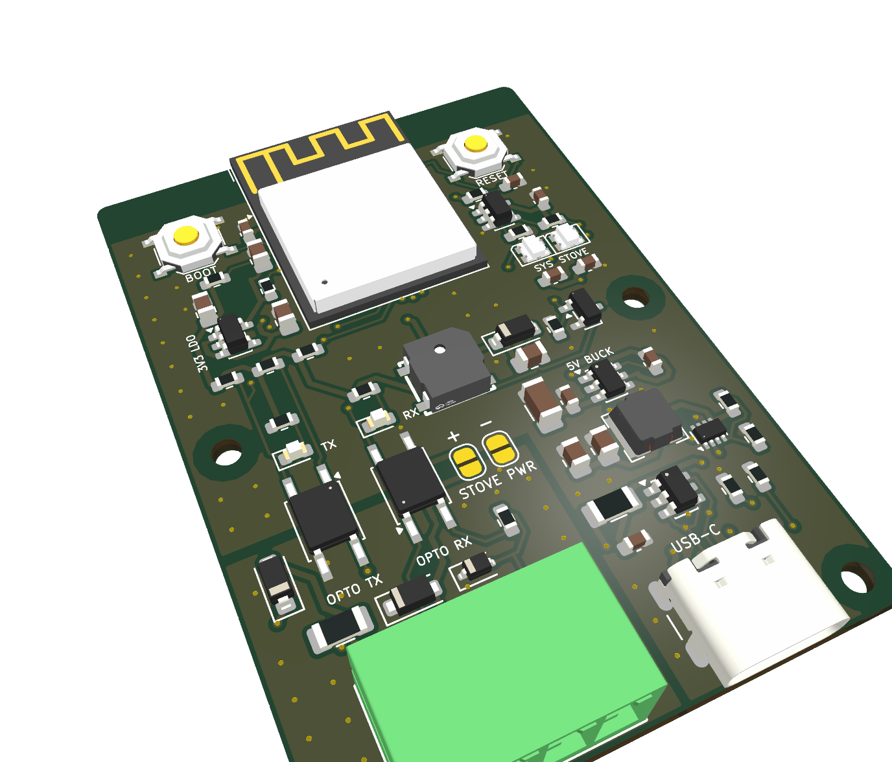
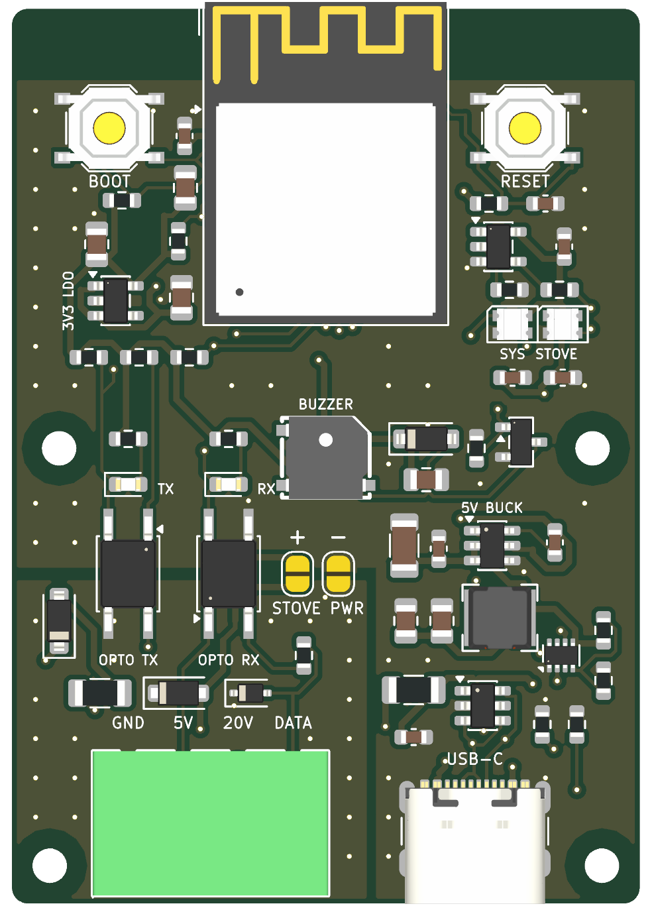
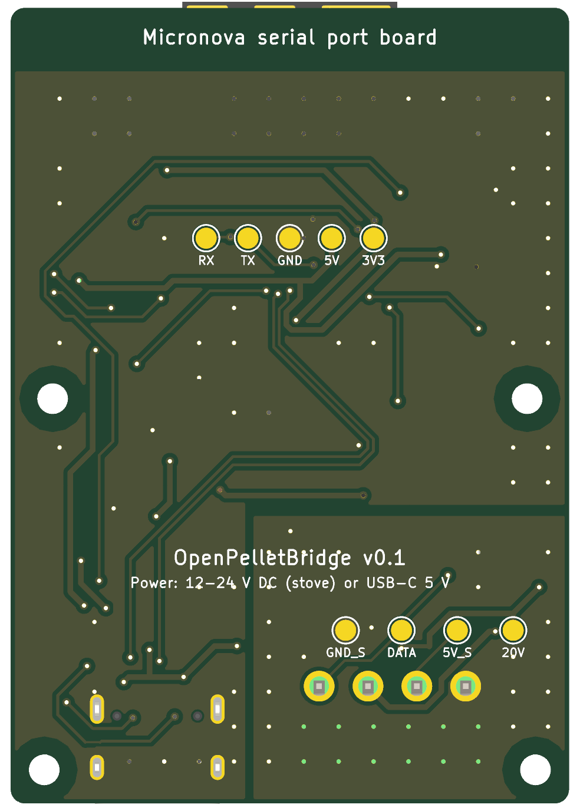
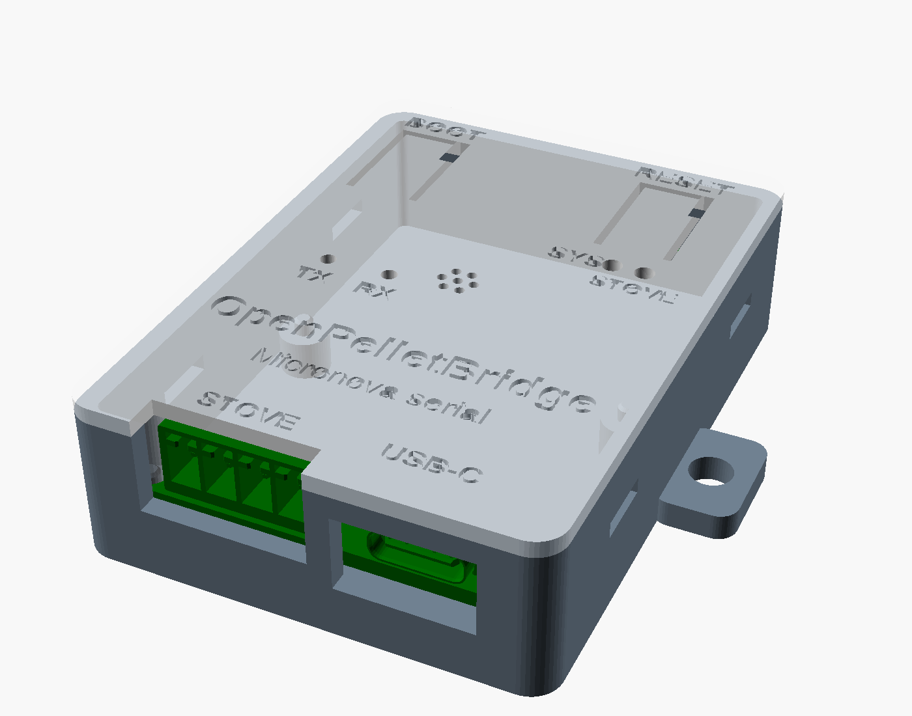
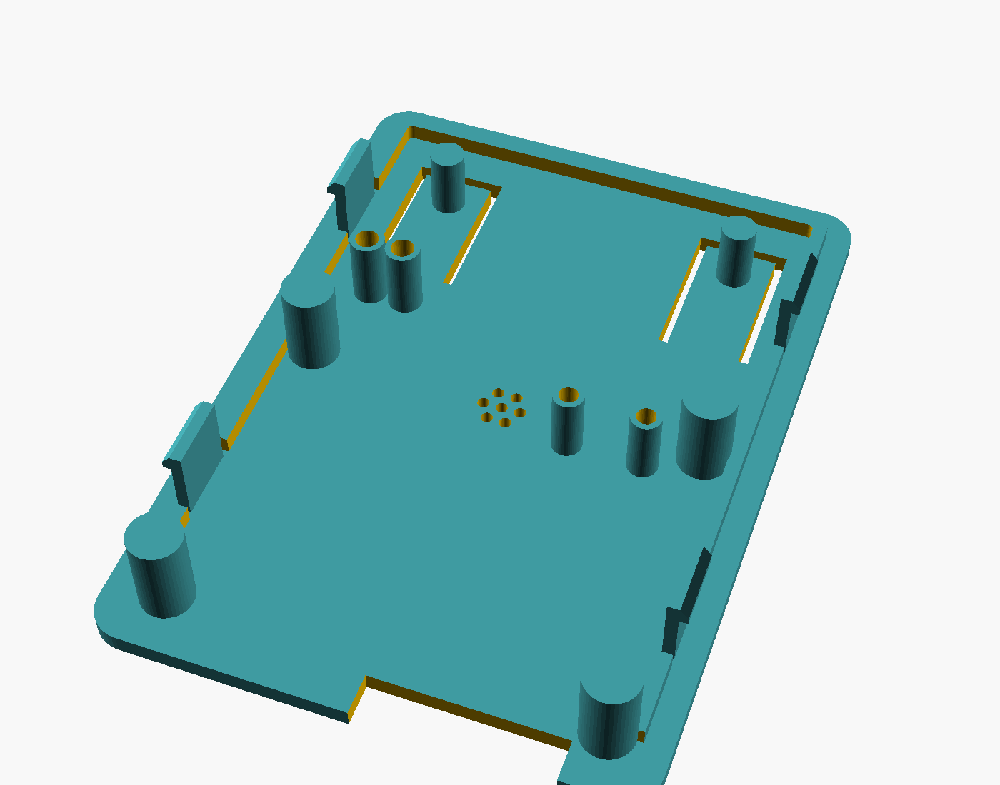

# Controller board (draft 0.1)

[← README](../README.md)

A small board for the controller: ESP32-S3 module, USB-C, power from the stove or from USB, an isolated interface to the Micronova serial line, status LEDs, a buzzer, two buttons, test pads and four M2 mounting holes. **Draft: schematic and a first routed PCB.** Have it reviewed before ordering.

| File | |
|---|---|
| [openpelletbridge/openpelletbridge.pdf](openpelletbridge/openpelletbridge.pdf) | Schematic (PDF) |
| [openpelletbridge/openpelletbridge.kicad_sch](openpelletbridge/openpelletbridge.kicad_sch) | KiCad 10 schematic (open the `.kicad_pro`) |
| [openpelletbridge/bom.csv](openpelletbridge/bom.csv) | Bill of materials |
| [TODO.md](TODO.md) | **What has to happen when the board is made and taken into use** (checks, firmware port) |
| [openpelletbridge/openpelletbridge.net](openpelletbridge/openpelletbridge.net) | Netlist |
| [openpelletbridge/openpelletbridge.kicad_pcb](openpelletbridge/openpelletbridge.kicad_pcb) | PCB, 40 × 57 mm, 2 layers |
| [tools/gen_schematic.py](tools/gen_schematic.py) | Generates the schematic: the netlist is defined there |
| [tools/gen_pcb.py](tools/gen_pcb.py) | Generates the PCB: placement, outline, rules, isolation, planes |
| [tools/build.sh](tools/build.sh) | Schematic → ERC → netlist → PCB → [Freerouting](https://github.com/freerouting/freerouting) → planes → DRC |

The schematic is generated: change [tools/gen_schematic.py](tools/gen_schematic.py), then

```bash
python3 hardware/tools/gen_schematic.py
cd hardware/openpelletbridge
kicad-cli sch erc --severity-all openpelletbridge.kicad_sch        # 0 violations
kicad-cli sch export pdf openpelletbridge.kicad_sch
```

The whole chain, PCB included (KiCad 10 and Java; Freerouting is the open-source autorouter):

```bash
FREEROUTING=/path/to/freerouting-2.5.0.jar hardware/tools/build.sh
```

Freerouting is chaotic: a small change can leave a few connections open, so the script tries three strategies (all nets at once, signals first, ground planes first) until DRC finds no unconnected item. Once the board is finished by hand in KiCad, the KiCad files become the source and the scripts are no longer used.

## PCB

  

40 × 57 mm, 2 layers, all parts on the top (THT: J1 shell, J2); the bottom has only test pads and text, so nothing is assembled there. Antenna at the top edge (no copper below it on either layer), USB-C and the stove connector side by side on the bottom edge. Ground planes on both layers with stitching vias: GND for the controller, GND_S on the stove side (bottom left). A copper-free strip separates the two sides under the optocouplers; only JP1 / JP2 cross it. Four M2 holes (not plated, no copper within 2.4 mm, so a metal screw or standoff connects nothing): two at the sides of the buzzer band, two in the bottom corners. The top corners are in the antenna keep-out of the module (Espressif: no metal within 15 mm of the antenna).

Rules: tracks 0.2 mm (power 0.4 mm), clearance 0.2 mm, vias 0.6 / 0.3 mm, 0.3 mm from the board edge: within the standard capabilities of the usual PCB makers. DRC: no errors, no unconnected items; the remaining warnings are silkscreen (module outline over the top edge, labels close to parts).

Silkscreen: descriptions instead of references (USB-C, OPTO TX / OPTO RX, BUZZER, 5V BUCK, 3V3 LDO; the references are in the assembly drawing), GND / 5V / 20V / DATA at the stove connector, RESET and BOOT at the buttons, SYS · STOVE under the status LEDs, TX and RX at the serial LEDs (each just above its optocoupler, so they read as part of the stove link), STOVE PWR with + (JP1, 20 V) and − (JP2, ground) at the solder jumpers. On the bottom: the names of the test pads, "Micronova serial port board" (in the copper-free antenna strip), the name and version, and the input range "Power: 12-24 V DC (stove) or USB-C 5 V".

Not yet done: a final manual review of the routing (the autorouter's tracks are functional, not pretty). Production files: see *Ordering* below; open checks: [TODO.md](TODO.md).

3D models the KiCad library lacks are in [openpelletbridge/3d](openpelletbridge/3d): the ESP32-S3-MINI-1 from Espressif's [kicad-libraries](https://github.com/espressif/kicad-libraries), the WS2812B-2020 (C965555), the TS-1187A buttons (C318884) and the Kefa header (C441173, footprint in [openpelletbridge/openpelletbridge.pretty](openpelletbridge/openpelletbridge.pretty)) from LCSC / EasyEDA (fetched with easyeda2kicad).

## Case

 

3D printable case, [case/openpelletbridge-case.scad](case/openpelletbridge-case.scad) ([OpenSCAD](https://openscad.org), parametric), ready to print: [base](case/openpelletbridge-case-base.stl) and [lid](case/openpelletbridge-case-lid.stl). Outside 45 × 62 × 16.4 mm (plus two mounting ears with a 4.2 mm hole; `ears = false` without).

- **No screws:** the board (1.6 mm) drops onto four standoffs whose 1.9 mm pegs go into its M2 holes, and the lid's four clamping tubes press it onto the standoffs. The lid clicks in with four snap hooks (two per long side) that catch in windows in the walls; to open, push the hooks in through the windows with a small screwdriver. (The board's holes are M2, 2.2 mm, not plated, no copper within 2.4 mm, if you ever want screws instead.)
- **Buttons:** BOOT and RESET are flexure tongues in the lid with a plunger 0.3 mm above the tactile switch.
- **LEDs:** light tubes from the lid down to just above SYS, STOVE, TX and RX (they also keep the colours apart). Print the lid in a translucent filament, or fill the holes with clear resin or a 2 mm light pipe.
- **Connectors:** opening for the USB-C cable's overmould (13 × 7.5 mm); the stove connector's notch is open through the lid, so a cable plug of any height fits.
- **Other:** sound holes above the buzzer, engraved labels. Plastic only near the antenna (top edge).
- **Print:** base upright, lid upside down (top face on the bed), 0.2 mm layers, no supports.
- **Checked** against the board's 3D model (KiCad STL export): no part of the case inside a component, and the lid's hooks sit in the windows, not in the walls. Regenerate after a board change: `kicad-cli pcb export stl --subst-models --user-origin 100x157mm -o case/board.stl openpelletbridge/openpelletbridge.kicad_pcb`, then `openscad -D 'part="base"' -o … case/openpelletbridge-case.scad` (`"lid"`, or `"assembly"` with the board).

## Design

| Block | Choice | Why |
|---|---|---|
| Module | ESP32-S3-MINI-1-N8 (15.4 × 20.5 mm) | 8 MB flash (the firmware uses 91 % of a 4 MB layout), dual core, BLE 5, native USB: no USB-serial chip or auto-reset circuit |
| USB | USB-C GCT USB4105-GF-A, 5.1 kΩ on CC1 / CC2, USBLC6-2SC6, 0.5 A PTC | Power and flashing / console from a PC; D+ / D- straight to IO20 / IO19 |
| Stove power | 20 V → AP63205 step-down → 5 V, 0.35 A / 30 V PTC, 24 V TVS | A 7805 from 20 V burns ~3 W at the WiFi peaks. Input range **12 – 24 V**: above 24 V the TVS starts to conduct; worst case (WiFi peak, buzzer, LEDs full white) the board takes ~2.9 W, 0.24 A at 12 V, below the 350 mA hold current of F2. The buck itself needs ~7 V for 5 V out. F2 mainly protects the stove: a short on this board, or the TVS clamping, trips it instead of loading the stove's supply |
| Stove 5 V | Only for the LED of the RX optocoupler U6 (a few mA) | The controller never runs from the stove's 5 V |
| Power mux | TPS2116 in priority mode: stove (VIN1) first, USB (VIN2) as fallback; then AP2112K-3.3 | Both sources at once: with the stove's 5 V present the board runs from the stove and USB only carries data. USB takes over when the stove's 5 V drops below ~4.3 V (33k / 10k on PR1; VREF 1.0 V ± 8 % gives 4.0 – 4.6 V). Break-before-make in ~8 µs (22 µF on +5V: ~0.2 V dip at 0.5 A), reverse current blocked both ways. ST → IO4: high = powered by the stove. Replaces two LM66100 ideal diodes, which had CE on GND and so did not block reverse current (TI: only with CE on VOUT) and had no priority between two ~5 V sources |
| Isolation | JP1 + JP2 (solder jumpers) | Open: USB powered, stove side galvanically isolated. Closed: powered by the stove; GND_S is then tied to GND (and to the PC on USB) |
| Serial line | 2× LTV-357T (SO-4) | Level shift 3.3 V ↔ 5 V and isolation; the stove side runs on the stove's 5 V |
| Echo | Kept | The firmware tells "bus not connected" (no echo) from "stove does not answer" (echo, no answer) |
| TX / RX LED | Two 0603 LEDs on the serial lines themselves (no GPIO), above the optocouplers | Red = TX, green = RX: both while sending (echo), green when the stove answers, red only = no bus. They stay on the ESP side of the isolation (3V3, STOVE_TX / STOVE_RX) |
| Reverse polarity | B5819W Schottky in series with the stove's 20 V (after F2) | The stove's pin order is not standard: a swapped cable gives no current instead of a dead step-down. ~0.3 V drop at 0.1 A, no matter for the step-down |
| Buzzer | MLT-5020 magnetic transducer 5 × 5 mm on 3.3 V, AO3400A on IO21, 1N4148W flyback diode, 10 kΩ pull-down, 10 µF buffer | Needs a PWM signal (~4 kHz, LEDC); ~110 mA while it sounds. Silent during boot (pull-down). Operating temperature −30 – 70 °C: mind the place inside the stove |
| Test pads | 9 pads (1.5 mm) on the bottom: 3V3, 5V, GND, TX, RX under the module; 20V, 5V_S, DATA, GND_S on the stove side | Measuring at bring-up without probing the parts |
| Status LEDs | 2× WS2812B-2020 on IO8 via SN74LV1T34 (R8 10 kΩ pull-down on its input) | LED1 system (WiFi / Bluetooth / telnet / power), LED2 stove state; any colour and blink pattern, one GPIO |
| Buttons | RESET (EN, 10 kΩ / 1 µF) and BOOT / USER (IO0) | IO0 held during reset = download mode; otherwise a user button |
| Stove connector | Cixi Kefa KF2EDGR-3.5-4P header (LCSC C441173, 3.5 mm, right angle, THT); cable plug **KF2EDGKD-3.5-4P** (LCSC C441073, spring terminals, wires up to 1.5 mm²) | Same series from one maker, both at LCSC, so the plug surely fits; push the wires in, no crimping. Footprint and 3D model from LCSC / EasyEDA (holes 1.4 mm: the Phoenix footprint has 1.2 mm) |

### Serial interface

```
TX:  +3V3 ─ R5 220 ─ LED(U5) ─ STOVE_TX (IO17)          U5 transistor: DATA_S ─ GND_S
RX:  +5V_S ─ LED(U6) ─ R6 1.5k ─ DATA_S                  U6 transistor: STOVE_RX (IO18, 10k pull-up) ─ GND
```

STOVE_TX low switches U5 on and pulls the stove's data line low. Whenever DATA is low (the stove or our own TX), U6 pulls STOVE_RX low. R12 keeps STOVE_TX high while the ESP boots, so nothing reaches the bus before the UART runs. At 1200 baud (833 µs per bit) the optocouplers are fast enough.

Currents (Vf: optocoupler LED ~1.2 V, D5 / D6 ~2 V):

| Path | Current |
|---|---|
| IO17 low: U5 LED (R5 220) + D5 (R10 1.5k) + R12 | 9.5 + 0.9 + 0.3 = **10.7 mA** sunk by IO17 |
| DATA low: U6 LED from the stove's 5 V (R6 1.5k) | **2.5 mA**: the extra load on the stove's bus |
| U5 transistor, our TX | must sink the stove's pull-up + 2.5 mA; at CTR ≥ 100 % it can sink ≥ 9.5 mA, so the stove's pull-up may be down to ~750 Ω |
| U6 transistor, RX | R7 0.33 mA + D6 0.8 mA = 1.1 mA of the ≥ 2.5 mA it can sink |

D5 / D6 cannot change the logic levels: each sits between 3V3 (through 1.5k) and a line that is either high (3.3 V: no current) or pulled low by IO17 / U6, which then sink 0.8 – 0.9 mA more. While the ESP boots, STOVE_TX is high-impedance and R12 holds it high: D5 and U5 stay off, nothing reaches the bus. The stove's DATA pull-up is not known: measure it before connecting (see [TODO.md](TODO.md)).

### GPIO

| GPIO | Use |
|---|---|
| IO17 | STOVE_TX (UART1 TX) |
| IO18 | STOVE_RX (UART1 RX) |
| IO8 | WS2812B data |
| IO0 | BOOT / user button |
| IO21 | Buzzer (PWM, via Q1) |
| IO4 | Power source (TPS2116 ST): high = stove, low = USB |
| IO19 / IO20 | USB D- / D+ |
| EN | RESET button |

The strapping pins IO3, IO45 and IO46 are left unconnected (their defaults are right). Free for later: IO1, IO2, IO5 – IO7, IO9 – IO16, IO33 – IO42, IO47, IO48 (IO35 – IO37 only because the N8 has no PSRAM); TXD0 / RXD0 (IO43 / IO44) are the ROM boot log.

## Ordering: two assemblers

Every part has an **LCSC** number (JLCPCB) and a **Manufacturer + MPN** (Aisler and anyone buying at Mouser / DigiKey / Farnell). Where the LCSC part is a Chinese-market equivalent, the MPN is a part with the same footprint and pinout:

| Ref | LCSC (JLCPCB) | MPN (Aisler, Mouser, DigiKey) |
|---|---|---|
| R* | UNI-ROYAL 0603WAF… | YAGEO RC0603FR-07… |
| D5 / D6 | KENTO KT-0603R / KT-0603YG | Kingbright APT1608SURCK / APT1608CGCK |
| U8 | TI TPS2116DRLR (C3235557) | TI TPS2116DRLR |
| J1 | GCT USB4105-GF-A (C3020560): **not in JLCPCB's own stock; pre-order it from LCSC into your JLCPCB parts library** (Parts Manager → pre-order / global sourcing) | GCT USB4105-GF-A |
| J2 | Cixi Kefa KF2EDGR-3.5-4P (plug KF2EDGKD-3.5-4P, C441073) | Phoenix Contact 1844236 (plug FMC 1,5/4-ST-3,5, 1952283) |
| LED1 / LED2 | Xinglight XL-2020RGBC-WS2812B | Worldsemi WS2812B-2020 |
| SW1 / SW2 | XKB TS-1187A-B-A-B | C&K PTS526 SM15 SMTR2 LFS |
| D8 | JSCJ B5819W SL | onsemi MBR0540T1G |
| BZ1 | Huaneng MLT-5020 | Same Sky CMT-5023S-SMT-TR (same 5 × 5 mm size; **pads not checked** against this footprint) |

Files in `openpelletbridge/production/`: JLCPCB `bom-jlcpcb.csv` + `cpl-jlcpcb.csv` (with the rotation / offset corrections for JLCPCB's part models); Aisler and others `bom-mpn.csv` + `positions.csv`, or the KiCad project itself (the footprints carry the Manufacturer / MPN fields).

## Open points

Kept in [TODO.md](TODO.md): checks before ordering, bring-up, firmware port.

## Firmware

The board needs an ESP32-S3 build of the firmware: see [TODO.md](TODO.md).
